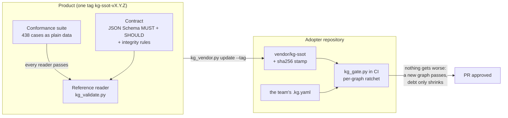

<div align="center">

# KG-SSOT

**Verifiable knowledge graphs in plain text: every claim says where it came from, when it was last verified and
what depends on it, and your CI rejects the ones that don't.**

**English** | [Português (Brasil)](README.pt-BR.md)

[](LICENSE)
[](spec/release.json)
[](spec/conformance/README.md)
[](tools/requirements.txt)
[](https://pypi.org/project/kg-ssot/)
[](https://www.npmjs.com/package/kg-ssot)
[](https://github.com/marciocar/kg-ssot/pkgs/container/kg-ssot)
[](https://registry.modelcontextprotocol.io/v0/servers?search=io.github.marciocar/kg-ssot)

[Manual](docs/manual/README.md) · [Adopt it](ADOPTING.md) · [The contract](docs/manual/04-contract.md) · [Conformance suite](spec/conformance/README.md) · [Changelog](CHANGELOG.md) · [For AI agents](llms.txt)

</div>

---

## Why

Teams, of people or of agents, pile up conclusions: "the retry is idempotent", "we decided on three attempts".
They live in meeting notes, tickets and chat memories, and on the way they lose three things: **the source**, **the
date it was last verified** and **what depends on it**. A convincing sentence without any of the three passes a
hurried review.

KG-SSOT treats this as a **format** problem, not a discipline problem. Knowledge lives in a `.kg.yaml` graph,
versioned next to the code, and a **formal contract** decides in CI what fails:

- a `confirmed` or production node **without provenance** fails (a claim with no recoverable source is declared
  `unverifiable` instead);
- a source that is only a placeholder (`unknown`, `n/a`, `tbd`) fails;
- an edge that points nowhere fails, and so does a node with no edges;
- a verification stamp with nothing to check against, a decision with no origin and a production claim backed only by
  testimony **raise warnings**.

## Get started in 60 seconds

```bash
pip install kg-ssot

# the conformance suite against the reference reader, from the installed package
kg-conformance | tail -2

# one valid graph and one that fails
kg-validate valid.kg.yaml broken.kg.yaml
```

Or straight from the repository, with hash-checked dependencies:

```bash
git clone https://github.com/marciocar/kg-ssot && cd kg-ssot
python3 -m venv .venv && .venv/bin/pip install --require-hashes -r tools/requirements.txt
.venv/bin/python3 -I tools/kg_validate.py \
  spec/conformance/fixtures/latest/form/minimal/valid-minimal.kg.yaml \
  spec/conformance/fixtures/latest/form/minimal/bad-node-missing-label.kg.yaml
```

```text
PASS spec/conformance/fixtures/latest/form/minimal/valid-minimal.kg.yaml
FAIL spec/conformance/fixtures/latest/form/minimal/bad-node-missing-label.kg.yaml
  MUST   form.required.node.label ×1
· 2 files; 1 pass the MUST; 0 with a SHOULD warning (kg-contract-v4.schema.json + kg-contract-v4.should.schema.json)
```

The tools print in English by default and in Brazilian Portuguese when your locale is `pt_BR` (or
`KG_SSOT_LANG=pt-BR`). Codes, exit codes and JSON keys never change with the language; only the human text does.

## Install

| Channel | Command | What you get |
|---|---|---|
| [PyPI](https://pypi.org/project/kg-ssot/) | `pip install kg-ssot` | The commands `kg-validate`, `kg-conformance`, `kg-gate`, `kg-store`, `kg-query`, `kg-diff`, `kg-vocab`, `kg-criterion`, `kg-audit`, `kg-mcp` and `kg-prov-export`, with the contract and the suite inside |
| [npm](https://www.npmjs.com/package/kg-ssot) | `npm install kg-ssot` | The JavaScript reader with a precompiled validator, which also runs in React Native and Expo |
| [Claude Desktop](https://github.com/marciocar/kg-ssot/releases/latest) | the `.mcpb` file from the [latest release](https://github.com/marciocar/kg-ssot/releases/latest) | The MCP server as a one-click extension |
| [MCP Registry](https://registry.modelcontextprotocol.io/v0/servers?search=io.github.marciocar/kg-ssot) | `io.github.marciocar/kg-ssot` | The same server for any MCP client |
| [Container](https://github.com/marciocar/kg-ssot/pkgs/container/kg-ssot) | `docker pull ghcr.io/marciocar/kg-ssot` | The MCP server as a service next to a client without Python, such as LibreChat |
| Your repository | `kg_vendor.py update --tag kg-ssot-v4.22.0` | The release vendored by tag, with a sha256 stamp, and the gate in your CI ([manual, chapter 6](docs/manual/06-adoption-and-ci.md)) |

## A node, inside

```yaml
- id: C_RETRY_SAFE
  node_type: claim
  plane: PROD
  status: confirmed
  impact: 4
  confidence: 0.8
  label: The payment retry is idempotent.
  verified_at: "2026-10-01"
  verified_against: tests/payment_retry_test.py
  provenance:
    source: tests/payment_retry_test.py
    locator: test_retry_is_idempotent
    method: "medição: integration test in CI"
```

The `label` is the claim, short. The `provenance` says where it came from and **how**: one of five method classes,
`medição` (measurement), `leitura` (reading), `juízes` (judges), `derivado` (derived) or `testemunho` (testimony).
The stamp says when it was verified and against what. The method classes are literal values of the contract and stay
as written.

## Use it from an AI agent

The reference MCP server gives a model the contract and a store: it validates a graph, writes only what passes,
reads, lists, queries with every edge resolved to the label on the other end, and shows history. Read-only tools are
annotated as such, so a client can skip confirmation for them.

```bash
kg-mcp --root ./graphs          # stdio, for Claude Desktop, Claude Code and other MCP clients
```

`kg_schema_help` returns the current contract, a minimal passing example and the fixes for the most common codes, so a
model can write a passing graph on the first try. [llms.txt](llms.txt) indexes the documentation for agents, and
[llms-full.txt](llms-full.txt) has all of it in one file.

## How it works



1. **The contract** is JSON Schema 2020-12 at two levels: **MUST** fails, **SHOULD** warns. The rules a schema
   cannot express (unique ids, existing edge ends, orphan nodes) are part of it.
2. **The suite** is the compatibility proof: each case is a real YAML file with the expected verdict and codes, and a
   reader passes only if it emits **exactly** the same codes.
3. **The kit** brings the contract to a repository by tag, with a stamp that fails local edits, and runs the
   **per-graph ratchet** in CI: what already failed becomes named debt, a new graph has to pass, and the debt only
   shrinks.

## Features

| | |
|---|---|
| **Two-level contract** | MUST fails, SHOULD warns, with a ramp: what warns in one version can fail in the next, and the adopter sees it coming |
| **Structured provenance** | `source`, `locator` and `method`, with five evidence classes and the source locality (`repo`, `web`, `host`, `pessoa`, `privado`) |
| **Verification stamp** | `verified_at` and `verified_against`, with a warning for a stamp with no target and for a verification dated before the fact |
| **Edges between graphs** | `external_edges`, with the far end checked against the corpus |
| **Stable codes** | Every violation has a code such as `form.required.node.provenance`, and `--where` names the node |
| **Structured verdict** | `kg_validate.py --format json` returns the verdict with code, document path, line, message and fix hint, in a versioned format (`spec/verdict.schema.json`) for tools and MCP servers |
| **Two formats, one model** | `.kg.yaml` to write and review in a diff, and `.kg.json` for runtime use (an app, a server), read by a JSON parser under the contract's JSON profile (RFC 8259, I-JSON, up to 128 levels, unique keys) |
| **Gated store** | `kg_store.py` writes `.kg.yaml` or `.kg.json` to disk, a git repository or a versioned store, only after the contract passes, with external edges checked in the store and optimistic locking for concurrent writers |
| **Reference MCP server** | `kg_mcp.py` serves the contract and the store over MCP (stdio, or HTTP behind a proxy with per-identity areas), with tool annotations |
| **Query and diff** | `kg_query.py` selects nodes across a whole corpus and projects every edge with the label on the other end, paginated (`kg-ssot.query/1`); `kg_diff.py` compares revisions by id, field by field, reading git without a checkout (`kg-ssot.diff/1`) |
| **Domain vocabulary** | The `x_term` profile gives each synonym its source, document version and verification date; `kg_vocab.py` resolves a text to its term, lists what is due, and exports to SKOS-XL and Apache Ossie (`kg-ssot.vocab/1`); the MCP server serves it as `kg_terms` |
| **Pre-registered criterion** | `x_criterion` gives each version of a yardstick a node and a `sha256`, and `x_measured_under` ties a result to the version it was measured under; changing the yardstick after seeing the data shows up as a post-hoc warning, and `kg_criterion.py` checks the `sha256` against the text or the file (`kg-ssot.criterion/1`) |
| **Audit package by question** | `kg_audit.py` exports one row per questionnaire item (the `x_questionnaire` profile), with the question, the answer, the verdict, the required and the given evidence with its date and due date, the evidence requests (`role: evidence_request` and `evidence_requirement`), the contradictions, the owner, and the gaps it computes, in CSV, XLSX (no dependency), or JSON (`kg-ssot.audit/1`) |
| **Data-only suite** | 438 cases with their own metaschema, in the style of the JSON-Schema-Test-Suite |
| **Per-graph ratchet** | Adopt without a big-bang migration: inherited debt stays named and only shrinks |
| **Vendor by tag** | No copy-paste, no shared code: one sha256 stamp per file |
| **Profile-driven migrator** | `kg_migrate.py` proposes the `provenance` the contract asks for, from rules the adopter declares, shows the plan first and writes with node-by-node invariance |
| **PROV-O bridge** | `kg_prov_export.py` exports each node's provenance as `prov:Entity` and `prov:Derivation` in JSON-LD, for the W3C PROV ecosystem |
| **No platform** | Python 3.11 or later, PyYAML and jsonschema, installed with checked hashes (`--require-hashes`). No server, editor or assistant required |

## What KG-SSOT is not

| If you need... | ...use something else | What KG-SSOT gives you |
|---|---|---|
| A query language over a large graph | A graph database | A file format and a contract, with no server |
| Semantic web interoperability | RDF, OWL, SHACL | A small, closed YAML vocabulary that reads well in a diff, and a PROV-O export |
| Enterprise search over documents | A search platform | No connectors or index: only the graph the team writes |
| A guarantee that a claim is **true** | Human review, tests | The guarantee that it **says** where it came from and when it was verified |

## Status

- **Current:** contract v4, release `kg-ssot-v4.22.0`. The reference reader passes 424 of 438 cases in `latest/`.
- **In use:** three adopters run the gate in CI, one of them in production.
- **Next:** v5 will fail a `method` outside the `<class>: <detail>` form, which only warns today.
- **Open:** the semantic layer (freshness, contradiction, domain completeness) lives in `optional/`, and the reference
  reader does not implement it: it passes only the 10 valid cases there.

## Documentation

| | |
|---|---|
| [Manual](docs/manual/README.md) | Concepts, format, contract, tools, recipes and troubleshooting |
| [ADOPTING.md](ADOPTING.md) | The complete adoption guide, with every edge case |
| [The contract](docs/manual/04-contract.md) | Contract v4: the two levels, the codes and what changes between versions |
| [spec/conformance/](spec/conformance/README.md) | The suite format, the codes and how to measure a reader in another language |
| [CHANGELOG.md](CHANGELOG.md) | Every release, newest first |
| [llms.txt](llms.txt) · [llms-full.txt](llms-full.txt) | For AI agents: the index with links, and the whole documentation in one file |

## Contributing

A contract change starts with a **conformance case**: the `.kg.yaml` that shows the behavior and the expected verdict.
Releases are tags `kg-ssot-vX.Y.Z` of the development repository, where every pull request that touches `spec/` or
`tools/` runs the suite and the kit tests in CI. The release mirror holds only what each tag ships, one commit per
tag, and does not take pull requests: a proposal or a bug goes in as an
[issue](https://github.com/marciocar/kg-ssot/issues), ideally with the case that shows it. A reader in another
language is welcome: [chapter 7 of the manual](docs/manual/07-conformance-and-readers.md) explains how to measure it.

## License

The product (what the release ships, listed in [`spec/release.json`](spec/release.json): the contract, the suite, the
`.kg.yaml` cases, the kit in `tools/`, `ADOPTING.md`, this README and the manual) is **Apache-2.0**:
[`LICENSE`](LICENSE), with the scope in [`NOTICE`](NOTICE).

<sub>KG-SSOT was born inside the Onion framework, which now adopts it by tag like any other adopter. The product does
not depend on it.</sub>
