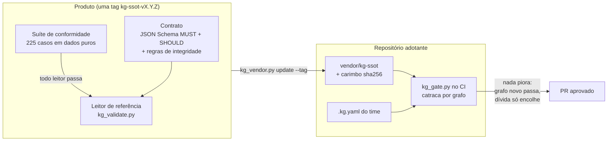

<div align="center">

# KG-SSOT

**O grafo de conhecimento verificável: toda afirmação diz de onde veio, quando foi conferida e o que depende
dela, e o CI recusa a que não diz.**

[](LICENSE)
[](spec/release.json)
[](spec/conformance/README.md)
[](tools/requirements.txt)

[Manual](docs/manual/README.md) · [Adotar](ADOPTING.md) · [Contrato](docs/manual/04-contrato.md) · [Suíte](spec/conformance/README.md)

</div>

---

## Por que

Equipes, de pessoas ou de agentes, acumulam conclusões: "o retry é idempotente", "decidimos três tentativas".
Elas moram em atas, tickets e memórias de conversa, e perdem três coisas pelo caminho: **a fonte**, **a data da
conferência** e **o que depende delas**. Um texto convincente sem nenhuma das três passa em qualquer revisão
apressada.

O KG-SSOT trata isso como problema de **formato**, não de disciplina. O conhecimento vive num grafo `.kg.yaml`,
versionado junto do código, e um **contrato formal** decide no CI o que reprova:

- um nó `confirmed` ou de produção **sem proveniência** reprova;
- uma fonte que é só um marcador (`unknown`, `n/a`, `tbd`) reprova;
- uma aresta que aponta para o nada reprova, e um nó solto também;
- um carimbo de verificação sem alvo, uma decisão sem origem e uma produção apoiada só em relato **alertam**.

## Comece em 60 segundos

```bash
git clone <este repositório> kg-ssot && cd kg-ssot
python3 -m venv .venv && .venv/bin/pip install -r tools/requirements.txt

# a suíte de conformidade contra o leitor de referência
.venv/bin/python3 -I tools/kg_conformance.py | tail -2

# um grafo válido e um que reprova
.venv/bin/python3 -I tools/kg_validate.py \
  spec/conformance/fixtures/latest/form/minimal/valid-minimal.kg.yaml \
  spec/conformance/fixtures/latest/form/minimal/bad-node-missing-label.kg.yaml
```

```text
latest: 225/225 (reprova)
optional: 10/24 (só reporta)
PASSA   spec/conformance/fixtures/latest/form/minimal/valid-minimal.kg.yaml
REPROVA spec/conformance/fixtures/latest/form/minimal/bad-node-missing-label.kg.yaml
  MUST   form.required.node.label ×1
· 2 arquivos; 1 passam no MUST; 0 com aviso SHOULD (kg-contract-v4.schema.json + kg-contract-v4.should.schema.json)
```

Para levar a um repositório seu, o caminho é o [capítulo 6 do manual](docs/manual/06-adocao-e-ci.md).

## Um nó, por dentro

```yaml
- id: C_RETRY_SAFE
  node_type: claim
  plane: PROD
  status: confirmed
  impact: 4
  confidence: 0.8
  label: O retry do pagamento é idempotente.
  verified_at: "2026-10-01"
  verified_against: tests/payment_retry_test.py
  provenance:
    source: tests/payment_retry_test.py
    locator: test_retry_is_idempotent
    method: "medição: teste de integração no CI"
```

O `label` é o fato, curto. A `provenance` diz de onde ele veio e **como**: `medição`, `leitura`, `juízes`,
`derivado` ou `testemunho`. O carimbo diz quando foi conferido e contra o quê.

## Como funciona



1. **O contrato** é JSON Schema 2020-12 em dois níveis: **MUST** reprova, **SHOULD** alerta. As regras que o
   schema não alcança (ids únicos, pontas existentes, nó órfão) são parte dele.
2. **A suíte** é a prova de compatibilidade: cada caso é um `.kg.yaml` real com o veredito e os códigos
   esperados, e o leitor passa só se emitir **exatamente** os mesmos códigos.
3. **O kit** leva o contrato a um repositório por tag, com um carimbo que reprova edição local, e roda a
   **catraca por grafo** no CI: o que já reprovava vira dívida nomeada, um grafo novo tem de passar, e a dívida
   só encolhe.

## Recursos

| | |
|---|---|
| **Contrato em dois níveis** | MUST reprova, SHOULD alerta, com uma rampa: o que alerta numa versão pode reprovar na seguinte, e o adotante vê antes |
| **Proveniência estruturada** | `source`, `locator` e `method`, com cinco classes de evidência e a localidade da fonte (`repo`, `web`, `host`, `pessoa`) |
| **Carimbo de verificação** | `verified_at` e `verified_against`, com aviso para carimbo sem alvo e verificação anterior ao fato |
| **Arestas entre grafos** | `external_edges` com a ponta externa conferida no corpus |
| **Códigos estáveis** | Toda violação tem um código como `form.required.node.provenance`, e `--where` diz o nó |
| **Suíte em dados puros** | 225 casos com metaschema próprio, no molde da JSON-Schema-Test-Suite |
| **Catraca por grafo** | Adoção sem migração de uma vez: a dívida herdada fica nomeada e só encolhe |
| **Vendor por tag** | Sem copiar à mão, sem código compartilhado: um carimbo sha256 por arquivo |
| **Ponte para PROV-O** | `kg_prov_export.py` exporta a proveniência de cada nó como `prov:Entity` e `prov:Derivation` em JSON-LD, para ferramentas do ecossistema W3C PROV |
| **Sem plataforma** | Python 3, PyYAML e jsonschema. Nenhum servidor, nenhum editor, nenhum assistente obrigatório |

## O que o KG-SSOT não é

| Se você precisa de... | ...use outra coisa | O KG-SSOT oferece |
|---|---|---|
| Consultar um grafo grande com uma linguagem de consulta | Um banco de grafos | Um formato de arquivo e um contrato, sem servidor |
| Interoperar com a web semântica | RDF, OWL, SHACL | Um vocabulário YAML pequeno e fechado, legível no diff |
| Busca corporativa sobre documentos | Uma plataforma de busca | Nenhum conector nem índice: só o grafo que o time escreve |
| Garantir que uma afirmação é **verdadeira** | Revisão humana, testes | A garantia de que ela **diz** de onde veio e quando foi conferida |

## Estado e próximos passos

- **Vigente:** contrato v4, release `kg-ssot-v4.4.0`. O leitor de referência passa em 225 de 225 casos de
  `latest/`.
- **Em uso:** um adotante de produção valida os grafos dele no CI pela catraca do v4. O critério de "estável" é 30
  dias de uso contínuo sem mudança que quebre, e esse relógio fecha em 2026-11-08.
- **Próximo:** o v5 passa a reprovar o `method` fora da forma `<classe>: <detalhe>`, que hoje só alerta.
- **Aberto:** a camada semântica (frescor, contradição, completude de domínio) está em `optional/`, e o leitor de
  referência não a implementa: passa só nos 10 casos válidos, e os 14 que esperam um aviso ou uma reprovação
  semântica falham.

## Documentação

| | |
|---|---|
| [Manual](docs/manual/README.md) | Conceitos, formato, contrato, ferramentas, receitas e solução de problemas |
| [ADOPTING.md](ADOPTING.md) | O guia completo de adoção, com cada caso de borda |
| [Contrato](docs/manual/04-contrato.md) | O contrato v4: os dois níveis, os códigos e o que muda entre versões |
| [spec/conformance/](spec/conformance/README.md) | O formato da suíte, os códigos e o contrato de runner |

## Contribuir

Uma mudança no contrato começa por um **caso de conformidade**: o `.kg.yaml` que mostra o comportamento e o
veredito esperado. As releases saem como tags `kg-ssot-vX.Y.Z` do repositório de desenvolvimento, onde todo PR que
toca `spec/` ou `tools/` roda a suíte e os testes do kit no CI. O espelho das releases guarda só o que cada tag leva,
um commit por tag, e não recebe PR: uma proposta vai ao mantenedor e entra pelo repositório de desenvolvimento. Um leitor em outra linguagem é bem-vindo: o [capítulo 7 do manual](docs/manual/07-conformidade-e-leitores.md) diz como medi-lo.

## Licença

O produto (o que a release leva, listado em [`spec/release.json`](spec/release.json): o contrato, a suíte, os
casos `.kg.yaml`, o kit em `tools/`, o `ADOPTING.md`, este README e o manual) é **Apache-2.0**:
[`LICENSE`](LICENSE), com o escopo no [`NOTICE`](NOTICE).

Os casos `.kg.yaml` da suíte são parte do contrato e seguem a Apache-2.0.

O repositório de desenvolvimento guarda também o framework Onion vendorizado, com licença própria: o código que
executa segue MIT e o material de método segue CC BY-NC 4.0, cada um no seu arquivo de licença na raiz daquele
repositório. Nada disso viaja na release.

<sub>O KG-SSOT nasceu dentro do framework Onion, que hoje o adota por tag, como qualquer outro adotante. O produto
não depende dele.</sub>
