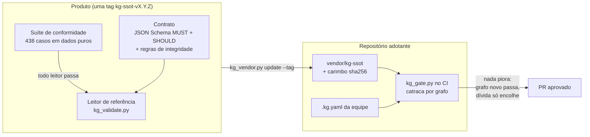

<!-- translation-of: README.md sha256:a5049cd603276399 -->
<div align="center">

# KG-SSOT

**Grafos de conhecimento verificáveis em texto puro: toda afirmação diz de onde veio, quando foi conferida pela
última vez e o que depende dela, e o seu CI recusa as que não dizem.**

[English](README.md) | **Português (Brasil)**

<sub>Tradução do original em inglês; quando os dois divergirem, vale o inglês.</sub>

[](LICENSE)
[](spec/release.json)
[](spec/conformance/README.pt-BR.md)
[](tools/requirements.txt)
[](https://pypi.org/project/kg-ssot/)
[](https://www.npmjs.com/package/kg-ssot)
[](https://github.com/marciocar/kg-ssot/pkgs/container/kg-ssot)
[](https://registry.modelcontextprotocol.io/v0/servers?search=io.github.marciocar/kg-ssot)

[Manual](docs/manual/pt-BR/README.md) · [Adotar](ADOPTING.pt-BR.md) · [O contrato](docs/manual/pt-BR/04-contrato.md) · [Suíte de conformidade](spec/conformance/README.pt-BR.md) · [Changelog](CHANGELOG.pt-BR.md) · [Para agentes de IA](llms.txt)

</div>

---

## Por que

Equipes, de pessoas ou de agentes, acumulam conclusões: "o retry é idempotente", "decidimos por três tentativas".
Elas moram em atas, tickets e memórias de conversa, e no caminho perdem três coisas: **a fonte**, **a data da última
conferência** e **o que depende delas**. Uma frase convincente sem nenhuma das três passa numa revisão apressada.

O KG-SSOT trata isso como problema de **formato**, não de disciplina. O conhecimento vive num grafo `.kg.yaml`,
versionado junto do código, e um **contrato formal** decide no CI o que reprova:

- um nó `confirmed` ou de produção **sem proveniência** reprova (uma afirmação sem fonte recuperável se declara
  `unverifiable` em vez disso);
- uma fonte que é só um marcador (`unknown`, `n/a`, `tbd`) reprova;
- uma aresta que aponta para o nada reprova, e um nó sem arestas também;
- um carimbo de verificação sem nada contra o que conferir, uma decisão sem origem e uma afirmação de produção
  apoiada só em testemunho **geram avisos**.

## Comece em 60 segundos

```bash
pip install kg-ssot

# a suíte de conformidade contra o leitor de referência, a partir do pacote instalado
kg-conformance | tail -2

# um grafo válido e um que reprova
kg-validate valid.kg.yaml broken.kg.yaml
```

Ou direto do repositório, com as dependências conferidas por hash:

```bash
git clone https://github.com/marciocar/kg-ssot && cd kg-ssot
python3 -m venv .venv && .venv/bin/pip install --require-hashes -r tools/requirements.txt
.venv/bin/python3 -I tools/kg_validate.py \
  spec/conformance/fixtures/latest/form/minimal/valid-minimal.kg.yaml \
  spec/conformance/fixtures/latest/form/minimal/bad-node-missing-label.kg.yaml
```

```text
PASSA   spec/conformance/fixtures/latest/form/minimal/valid-minimal.kg.yaml
REPROVA spec/conformance/fixtures/latest/form/minimal/bad-node-missing-label.kg.yaml
  MUST   form.required.node.label ×1
· 2 arquivos; 1 passam no MUST; 0 com aviso SHOULD (kg-contract-v4.schema.json + kg-contract-v4.should.schema.json)
```

As ferramentas imprimem em inglês por padrão e em português do Brasil quando o seu locale é `pt_BR` (ou
`KG_SSOT_LANG=pt-BR`). Os códigos, os códigos de saída e as chaves do JSON nunca mudam com a língua; só o texto para pessoas muda.

## Instalar

| Canal | Comando | O que você recebe |
|---|---|---|
| [PyPI](https://pypi.org/project/kg-ssot/) | `pip install kg-ssot` | Os comandos `kg-validate`, `kg-conformance`, `kg-gate`, `kg-store`, `kg-query`, `kg-diff`, `kg-vocab`, `kg-criterion`, `kg-audit`, `kg-mcp` e `kg-prov-export`, com o contrato e a suíte dentro |
| [npm](https://www.npmjs.com/package/kg-ssot) | `npm install kg-ssot` | O leitor JavaScript com um validador pré-compilado, que roda também no React Native e no Expo |
| [Claude Desktop](https://github.com/marciocar/kg-ssot/releases/latest) | o arquivo `.mcpb` da [última release](https://github.com/marciocar/kg-ssot/releases/latest) | O servidor MCP como extensão de um clique |
| [MCP Registry](https://registry.modelcontextprotocol.io/v0/servers?search=io.github.marciocar/kg-ssot) | `io.github.marciocar/kg-ssot` | O mesmo servidor para qualquer cliente MCP |
| [Contêiner](https://github.com/marciocar/kg-ssot/pkgs/container/kg-ssot) | `docker pull ghcr.io/marciocar/kg-ssot` | O servidor MCP como serviço ao lado de um cliente sem Python, como o LibreChat |
| O seu repositório | `kg_vendor.py update --tag kg-ssot-v4.22.0` | A release vendorizada por tag, com um carimbo sha256, e o gate no seu CI ([manual, capítulo 6](docs/manual/pt-BR/06-adocao-e-ci.md)) |

## Um nó, por dentro

```yaml
- id: C_RETRY_SAFE
  node_type: claim
  plane: PROD
  status: confirmed
  impact: 4
  confidence: 0.8
  label: O retry do pagamento é idempotente.
  verified_at: "2026-10-01"
  verified_against: tests/payment_retry_test.py
  provenance:
    source: tests/payment_retry_test.py
    locator: test_retry_is_idempotent
    method: "medição: teste de integração no CI"
```

O `label` é a afirmação, curta. A `provenance` diz de onde ela veio e **como**: uma de cinco classes de `method`,
`medição`, `leitura`, `juízes`, `derivado` ou `testemunho`. O carimbo diz quando ela foi conferida e contra o quê.
As classes de `method` são valores literais do contrato e ficam como estão escritas.

## Use a partir de um agente de IA

O servidor MCP de referência dá a um modelo o contrato e um armazém: ele valida um grafo, grava só o que passa, lê,
lista, consulta com cada aresta resolvida para o label da outra ponta e mostra o histórico. As ferramentas só de
leitura vêm anotadas como tal, para que um cliente possa dispensar a confirmação delas.

```bash
kg-mcp --root ./graphs          # stdio, para o Claude Desktop, o Claude Code e outros clientes MCP
```

`kg_schema_help` devolve o contrato vigente, um exemplo mínimo que passa e as correções dos códigos mais comuns, para
que um modelo escreva um grafo que passa na primeira tentativa. O [llms.txt](llms.txt) indexa a documentação para
agentes, e o [llms-full.txt](llms-full.txt) traz toda ela num arquivo só.

## Como funciona



1. **O contrato** é JSON Schema 2020-12 em dois níveis: **MUST** reprova, **SHOULD** avisa. As regras que um schema
   não expressa (ids únicos, pontas de aresta existentes, nós órfãos) são parte dele.
2. **A suíte** é a prova de compatibilidade: cada caso é um arquivo YAML real com o veredito e os códigos esperados,
   e um leitor passa só se emitir **exatamente** os mesmos códigos.
3. **O kit** leva o contrato a um repositório por tag, com um carimbo que reprova edição local, e roda a **catraca
   por grafo** no CI: o que já reprovava vira dívida nomeada, um grafo novo tem de passar, e a dívida só encolhe.

## Recursos

| | |
|---|---|
| **Contrato em dois níveis** | MUST reprova, SHOULD avisa, com uma rampa: o que avisa numa versão pode reprovar na seguinte, e o adotante vê chegando |
| **Proveniência estruturada** | `source`, `locator` e `method`, com cinco classes de evidência e a localidade da fonte (`repo`, `web`, `host`, `pessoa`, `privado`) |
| **Carimbo de verificação** | `verified_at` e `verified_against`, com aviso para carimbo sem alvo e para verificação datada antes do fato |
| **Arestas entre grafos** | `external_edges`, com a ponta externa conferida contra o corpus |
| **Códigos estáveis** | Toda violação tem um código como `form.required.node.provenance`, e `--where` diz o nó |
| **Veredito estruturado** | `kg_validate.py --format json` devolve o veredito com código, caminho no documento, linha, mensagem e dica de correção, num formato versionado (`spec/verdict.schema.json`) para ferramentas e servidores MCP |
| **Dois formatos, um modelo** | `.kg.yaml` para escrever e revisar no diff, e `.kg.json` para o runtime (um app, um servidor), lido por um parser JSON sob o perfil JSON do contrato (RFC 8259, I-JSON, até 128 níveis, chaves únicas) |
| **Armazém com gate** | `kg_store.py` grava `.kg.yaml` ou `.kg.json` em disco, num repositório git ou num armazém versionado, só depois de o contrato passar, com as arestas externas conferidas no armazém e trava otimista para escritores concorrentes |
| **Servidor MCP de referência** | `kg_mcp.py` serve o contrato e o armazém por MCP (stdio, ou HTTP atrás de um proxy com áreas por identidade), com anotações de ferramenta |
| **Consulta e diff** | `kg_query.py` seleciona nós num corpus inteiro e projeta cada aresta com o label da outra ponta, paginado (`kg-ssot.query/1`); `kg_diff.py` compara revisões pelo id, campo a campo, lendo o git sem checkout (`kg-ssot.diff/1`) |
| **Vocabulário de domínio** | O perfil `x_term` dá a cada sinônimo a fonte, a versão do documento e a data de conferência; o `kg_vocab.py` resolve um texto para o termo, lista o que vence e exporta para SKOS-XL e Apache Ossie (`kg-ssot.vocab/1`); o servidor MCP o serve como `kg_terms` |
| **Critério pré-registrado** | O `x_criterion` dá a cada versão de uma régua um nó e um `sha256`, e o `x_measured_under` prende o resultado à versão sob a qual foi medido; trocar a régua depois de ver o dado aparece como aviso post-hoc, e o `kg_criterion.py` confere o `sha256` contra o texto ou o arquivo (`kg-ssot.criterion/1`) |
| **Pacote de auditoria por pergunta** | O `kg_audit.py` exporta uma linha por item de questionário (o perfil `x_questionnaire`), com a pergunta, a resposta, o veredito, a evidência exigida e a dada, com a data e o vencimento, os pedidos de evidência (`role: evidence_request` e `evidence_requirement`), as contradições, o dono e as lacunas que ele calcula, em CSV, XLSX (sem dependência) ou JSON (`kg-ssot.audit/1`) |
| **Suíte em dados puros** | 438 casos com metaschema próprio, no estilo da JSON-Schema-Test-Suite |
| **Catraca por grafo** | Adote sem migração de uma vez: a dívida herdada fica nomeada e só encolhe |
| **Vendor por tag** | Sem copiar e colar, sem código compartilhado: um carimbo sha256 por arquivo |
| **Migrador por perfil** | `kg_migrate.py` propõe a `provenance` que o contrato pede, a partir de regras que o adotante declara, mostra o plano antes e grava com invariância nó a nó |
| **Ponte para PROV-O** | `kg_prov_export.py` exporta a proveniência de cada nó como `prov:Entity` e `prov:Derivation` em JSON-LD, para o ecossistema W3C PROV |
| **Sem plataforma** | Python 3.11 ou mais recente, PyYAML e jsonschema, instalados com hashes conferidos (`--require-hashes`). Nenhum servidor, editor ou assistente obrigatório |

## O que o KG-SSOT não é

| Se você precisa de... | ...use outra coisa | O que o KG-SSOT oferece |
|---|---|---|
| Uma linguagem de consulta sobre um grafo grande | Um banco de grafos | Um formato de arquivo e um contrato, sem servidor |
| Interoperabilidade com a web semântica | RDF, OWL, SHACL | Um vocabulário YAML pequeno e fechado, que se lê bem num diff, e uma exportação PROV-O |
| Busca corporativa sobre documentos | Uma plataforma de busca | Nenhum conector nem índice: só o grafo que a equipe escreve |
| A garantia de que uma afirmação é **verdadeira** | Revisão humana, testes | A garantia de que ela **diz** de onde veio e quando foi conferida |

## Estado

- **Vigente:** contrato v4, release `kg-ssot-v4.22.0`. O leitor de referência passa em 424 de 438 casos de `latest/`.
- **Em uso:** três adotantes rodam o gate no CI, um deles em produção.
- **Próximo:** o v5 vai reprovar um `method` fora da forma `<classe>: <detalhe>`, que hoje só avisa.
- **Aberto:** a camada semântica (frescor, contradição, completude de domínio) vive em `optional/`, e o leitor de
  referência não a implementa: passa só nos 10 casos válidos de lá.

## Documentação

| | |
|---|---|
| [Manual](docs/manual/pt-BR/README.md) | Conceitos, formato, contrato, ferramentas, receitas e solução de problemas |
| [ADOPTING.pt-BR.md](ADOPTING.pt-BR.md) | O guia completo de adoção, com todos os casos de borda |
| [O contrato](docs/manual/pt-BR/04-contrato.md) | O contrato v4: os dois níveis, os códigos e o que muda entre versões |
| [spec/conformance/](spec/conformance/README.pt-BR.md) | O formato da suíte, os códigos e como medir um leitor em outra linguagem |
| [CHANGELOG.pt-BR.md](CHANGELOG.pt-BR.md) | Cada release, da mais nova para a mais antiga |
| [llms.txt](llms.txt) · [llms-full.txt](llms-full.txt) | Para agentes de IA: o índice com links, e a documentação inteira num arquivo só |

## Contribuir

Uma mudança no contrato começa por um **caso de conformidade**: o `.kg.yaml` que mostra o comportamento e o veredito
esperado. As releases são tags `kg-ssot-vX.Y.Z` do repositório de desenvolvimento, onde todo pull request que toca
`spec/` ou `tools/` roda a suíte e os testes do kit no CI. O espelho das releases guarda só o que cada tag leva, um
commit por tag, e não recebe pull requests: uma proposta ou um defeito entra como
[issue](https://github.com/marciocar/kg-ssot/issues), de preferência com o caso que o mostra. Um leitor em outra
linguagem é bem-vindo: o [capítulo 7 do manual](docs/manual/pt-BR/07-conformidade-e-leitores.md) explica como medi-lo.

## Licença

O produto (o que a release leva, listado em [`spec/release.json`](spec/release.json): o contrato, a suíte, os casos
`.kg.yaml`, o kit em `tools/`, o `ADOPTING.md`, este README e o manual) é **Apache-2.0**:
[`LICENSE`](LICENSE), com o escopo no [`NOTICE`](NOTICE).

<sub>O KG-SSOT nasceu dentro do framework Onion, que hoje o adota por tag como qualquer outro adotante. O produto não
depende dele.</sub>
