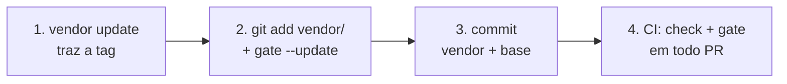

# 6. Adoção e CI

[← Ferramentas](05-ferramentas.md) · [Índice](README.md) · [Conformidade e leitores →](07-conformidade-e-leitores.md)

Este capítulo é o mapa. O guia completo, com cada caso de borda, é o [`ADOPTING.md`](../../ADOPTING.md).

## O caminho em quatro passos



Na raiz do seu repo, com Python 3.11 ou mais (o `rpds-py`, dependência do jsonschema, declara `Requires-Python >=3.11`):

```bash
# 1. trazer a release, por tag, do repositório público
git clone https://github.com/marciocar/kg-ssot ../kg-ssot
python3 -I -B ../kg-ssot/tools/kg_vendor.py update --tag kg-ssot-v4.8.2 --dest vendor/kg-ssot

# 2. as dependências num venv, e a linha de base (o gate só mede arquivo rastreado: git add antes)
python3 -m venv .venv && .venv/bin/pip install --require-hashes -r vendor/kg-ssot/tools/requirements.txt
echo .venv/ >> .gitignore
git add vendor/kg-ssot .gitignore docs/          # e os seus .kg.yaml, onde estiverem
.venv/bin/python3 -I -B vendor/kg-ssot/tools/kg_gate.py --update

# 3. commitar o vendor, com o carimbo, e a base
git add .kg-ssot/gate.json && git commit -m "adota o contrato KG-SSOT"
```

Os grafos que já reprovam viram dívida herdada, nomeada por caminho. O passo 4 é o CI, em todo PR: o workflow
completo do GitHub Actions está na seção "O passo de CI" do [`ADOPTING.md`](../../ADOPTING.md), e o passo em si é:

```yaml
- name: Contrato KG-SSOT (vendor íntegro + gate por grafo)
  run: |
    pip install --require-hashes -r vendor/kg-ssot/tools/requirements.txt
    python3 -I -B vendor/kg-ssot/tools/kg_vendor.py check --dest vendor/kg-ssot
    python3 -I -B vendor/kg-ssot/tools/kg_gate.py
```

## O que o gate garante

- Nenhum grafo **novo** entra reprovando no MUST.
- Nenhum grafo herdado ganha um código MUST que não tinha.
- A dívida SHOULD, por código, não sobe.
- Uma troca de contrato aparece no PR: a base guarda o nome e o sha256 dos schemas.

Consertar um grafo não compensa quebrar outro: a comparação do MUST é por grafo.

O gate mede só `.kg.yaml`. Um `.kg.json` no repositório fica fora dele, e quem quer o CI cobrando roda
`kg_validate.py` nesses arquivos num passo próprio.

## Atualizar a tag

No mesmo PR: `kg_vendor.py update` com a tag nova (de dentro do vendor, com
`--source https://github.com/marciocar/kg-ssot`), `git add vendor/kg-ssot`,
`kg_vendor.py check --dest vendor/kg-ssot --index` para conferir o que o commit vai levar (saindo de uma tag anterior à
4.8.1, rode o `update` duas vezes: o kit antigo não grava o `.gitattributes` do vendor, e o da 4.8.1 grava),
`kg_gate.py` para ver a diferença, e `kg_gate.py --update` para gravar a identidade nova. Se uma versão menor
trouxe um aviso SHOULD que o seu corpus já tinha, a dívida sobe por desenho, e o `--update` vai com
`--accept-regression "<motivo>"`.

## Subir de uma versão maior (v3 → v4)

O v4 reprova o que o v3 só alertava. A subida é pela **rampa**: os grafos que passam a reprovar entram na base
como dívida herdada, e a dívida só encolhe dali em diante. Não há truque de data no schema nem conserto do corpus
inteiro de uma vez. O passo a passo, com os comandos, está na seção "Do v3 para o v4" do
[`ADOPTING.md`](../../ADOPTING.md).

## Nota de ambiente

Em sistemas com PEP 668 (Ubuntu 24.04 em diante), o `pip install` fora de um venv é recusado. Use um venv e rode
o kit com o Python dele. No GitHub Actions com `actions/setup-python`, o `pip install` funciona direto.

## Num app

O KG-SSOT guarda **conhecimento sobre o produto**: decisões, regras de negócio, afirmações e a evidência de cada uma.
Não é banco de dados de runtime: o progresso, os pontos e a sequência de um usuário continuam no banco do app. O que
vai para o grafo é, por exemplo, "a sequência zera depois de um dia sem registro", com a fonte da decisão, a data em
que foi conferida e a aresta `TRACES_TO` até o código ou o teste que a implementa (a receita está no
[capítulo 8](08-receitas.md#uma-regra-de-negócio-ligada-ao-código)).

- **No CI:** o caminho acima vale para qualquer repo, de qualquer linguagem: o gate só precisa de Python no CI.
- **Em tempo de execução, em Python:** o kit não é pacote pip. Ponha `vendor/kg-ssot/tools` no `sys.path` e rode sem
  gravar bytecode, para o `check` do vendor seguir íntegro:

  ```python
  import sys
  sys.dont_write_bytecode = True                    # ou PYTHONDONTWRITEBYTECODE=1 no ambiente
  sys.path.insert(0, "vendor/kg-ssot/tools")
  import kg_store                                    # o armazém que só grava o que o contrato aprova
  store = kg_store.GitStore("/var/lib/meu-app/grafos", init=True)   # fora do repo do app
  ```

  A raiz do armazém fica **fora** do repo do app. Dentro de um repo git, o `DiskStore` e o `VersionedStore`
  recusam a raiz; o `GitStore` com a raiz no próprio repo commita no branch em que ele estiver, fora do PR, e numa
  subpasta do repo cria um repositório git aninhado.
- **Em outra linguagem:** não há leitor de referência pronto fora do Python. Valide pelo CLI
  (`kg_validate.py --format json` devolve o veredito JSON de `spec/verdict.schema.json`) ou por um modelo pelo
  servidor MCP (`kg_mcp.py`); um leitor próprio prova que concorda com o contrato passando na suíte (capítulo 7).
