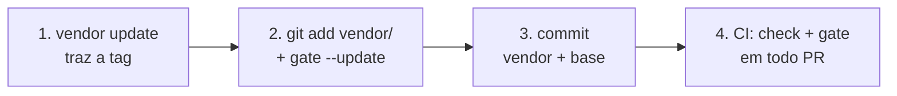

# 6. Adoção e CI

[← Ferramentas](05-ferramentas.md) · [Índice](README.md) · [Conformidade e leitores →](07-conformidade-e-leitores.md)

Este capítulo é o mapa. O guia completo, com cada caso de borda, é o [`ADOPTING.md`](../../ADOPTING.md).

## O caminho em quatro passos



1. **Trazer a release** para `vendor/kg-ssot`, por tag, com `kg_vendor.py update`.
2. **Gravar a linha de base.** `git add vendor/kg-ssot` vem antes, porque o gate só mede arquivo rastreado.
   Depois, `kg_gate.py --update`. Os grafos que já reprovam viram dívida herdada, nomeada por caminho.
3. **Commitar** o vendor inteiro, com o carimbo, e o `.kg-ssot/gate.json`.
4. **O passo de CI**, em todo PR:

```yaml
- name: Contrato KG-SSOT (vendor íntegro + gate por grafo)
  run: |
    pip install -r vendor/kg-ssot/tools/requirements.txt
    python3 -I -B vendor/kg-ssot/tools/kg_vendor.py check --dest vendor/kg-ssot
    python3 -I -B vendor/kg-ssot/tools/kg_gate.py
```

## O que o gate garante

- Nenhum grafo **novo** entra reprovando no MUST.
- Nenhum grafo herdado ganha um código MUST que não tinha.
- A dívida SHOULD, por código, não sobe.
- Uma troca de contrato aparece no PR: a base guarda o nome e o sha256 dos schemas.

Consertar um grafo não compensa quebrar outro: a comparação do MUST é por grafo.

## Atualizar a tag

No mesmo PR: `kg_vendor.py update` com a tag nova (de dentro do vendor, com `--source`), `git add vendor/kg-ssot`,
`kg_gate.py` para ver a diferença, e `kg_gate.py --update` para gravar a identidade nova. Se uma versão menor
trouxe um aviso SHOULD que o seu corpus já tinha, a dívida sobe por desenho, e o `--update` vai com
`--accept-regression "<motivo>"`.

## Subir de uma versão maior (v3 → v4)

O v4 reprova o que o v3 só alertava. A subida é pela **rampa**: os grafos que passam a reprovar entram na base
como dívida herdada, e a dívida só encolhe dali em diante. Não há truque de data no schema nem conserto do corpus
inteiro de uma vez. O passo a passo, com os comandos, está na seção "Do v3 para o v4" do
[`ADOPTING.md`](../../ADOPTING.md).

## Nota de ambiente

Em sistemas com PEP 668 (Ubuntu 24.04 em diante), o `pip install` fora de um venv é recusado. Use um venv e rode
o kit com o Python dele. No GitHub Actions com `actions/setup-python`, o `pip install` funciona direto.
