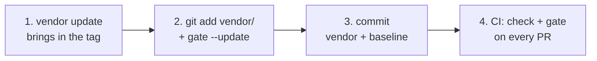

# 6. Adoption and CI

**English** | [Português (Brasil)](pt-BR/06-adocao-e-ci.md)

[← Tools](05-tools.md) · [Index](README.md) · [Conformance and readers →](07-conformance-and-readers.md)

This chapter is the map. The full guide, with every edge case, is [`ADOPTING.md`](../../ADOPTING.md).

## The four-step path



Run this at the root of your repository, with Python 3.11 or later (`rpds-py`, a jsonschema dependency, declares
`Requires-Python >=3.11`):

```bash
# 1. bring in the release, by tag, from the public repository
git clone https://github.com/marciocar/kg-ssot ../kg-ssot
python3 -I -B ../kg-ssot/tools/kg_vendor.py update --tag kg-ssot-v4.22.0 --dest vendor/kg-ssot

# 2. the dependencies in a venv, then the baseline (the gate only measures tracked files: git add first)
python3 -m venv .venv && .venv/bin/pip install --require-hashes -r vendor/kg-ssot/tools/requirements.txt
echo .venv/ >> .gitignore
git add vendor/kg-ssot .gitignore docs/          # and your .kg.yaml files, wherever they live
.venv/bin/python3 -I -B vendor/kg-ssot/tools/kg_gate.py --update

# 3. commit the vendor, with its stamp, and the baseline
git add .kg-ssot/gate && git commit -m "adopt the KG-SSOT contract"
```

Graphs that already fail become inherited debt, named by path. Step 4 is CI, on every PR. The full GitHub Actions
workflow is in section 3 of [`ADOPTING.md`](../../ADOPTING.md#3-the-ci-step), the CI step. The step itself is:

```yaml
- name: KG-SSOT contract (intact vendor + per-graph gate)
  run: |
    pip install --require-hashes -r vendor/kg-ssot/tools/requirements.txt
    python3 -I -B vendor/kg-ssot/tools/kg_vendor.py check --dest vendor/kg-ssot
    python3 -I -B vendor/kg-ssot/tools/kg_gate.py
```

## What the gate guarantees

- No **new** graph gets in while it fails MUST.
- No inherited graph gains a MUST code it did not have.
- The SHOULD debt, by code, does not go up.
- A contract change shows up in the PR: the baseline records the name and the sha256 of the schemas.

Fixing one graph does not make up for breaking another: the gate compares MUST graph by graph.

The gate measures only `.kg.yaml` files. A `.kg.json` file in the repository stays outside it. If you want CI to
check those files, run `kg_validate.py` on them in a step of its own.

## Output language in CI

Since 4.18.0, the tools print human output in English by default. They print it in Brazilian Portuguese when
`KG_SSOT_LANG=pt-BR` is set or the locale is `pt_BR`. The tools read the language in gettext order: `KG_SSOT_LANG`,
`LANGUAGE`, `LC_ALL`, `LC_MESSAGES`, `LANG`. The first variable that is set decides; an empty one is skipped. `C`,
`POSIX`, and a language with no catalog mean English.

Base the decision on the return code, never on the text. The gate returns rc 0 when nothing got worse, rc 1 when
something got worse, and rc 2 on broken input. Here is a failing gate in English, after a new graph that
fails MUST entered the PR (rc 1):

```text
✗ WORSE  docs/new.kg.yaml fails MUST: form.required.node.label
· 3 graphs; 1 pass MUST; 1 in the inherited debt
  MUST   docs/legacy.kg.yaml (inherited): form.required.node.plane
  MUST   docs/new.kg.yaml (new): form.required.node.label
```

With `KG_SSOT_LANG=pt-BR`, the same run prints `✗ PIOROU` in place of `✗ WORSE`. If a CI step searches the output
for text (`✗ WORSE` or `GATE BROKEN` from the gate, `PASS` or `BROKEN INPUT` from `kg_validate.py`), set
`KG_SSOT_LANG` in that step or match both languages. Data does not change language: the JSON keys, the codes, and
the place in a verdict (`nó X`, `aresta #n`) stay the same; only the `message` and `hint` text follows the language.

## Update the tag

Do it all in one PR:

1. Run `kg_vendor.py update` with the new tag. From inside the vendor, pass
   `--source https://github.com/marciocar/kg-ssot`.
2. Run `git add vendor/kg-ssot`.
3. Run `kg_vendor.py check --dest vendor/kg-ssot --index` to verify what the commit will carry. If you come from a
   tag older than 4.8.1, run `update` twice: the old kit does not write the vendor's `.gitattributes`, and the 4.8.1
   kit does.
4. Run `kg_gate.py` to see the difference.
5. Run `kg_gate.py --update` to record the new identity.

If a minor version brings a SHOULD warning that your corpus already had, the debt goes up by design. In that case,
run `--update` with `--accept-regression "<reason>"`.

## Move up a major version (v3 → v4)

v4 fails what v3 only warned about. You move up by the **ramp**: the graphs that start to fail enter the baseline
as inherited debt, and from then on the debt only shrinks. There is no date trick in the schema, and you do not
fix the whole corpus at once. The step-by-step guide, with the commands, is in section 5 of
[`ADOPTING.md`](../../ADOPTING.md#5-from-v3-to-v4), from v3 to v4.

## Environment note

On systems with PEP 668 (Ubuntu 24.04 and later), `pip install` outside a venv is refused. Use a venv and run the
kit with its Python. On GitHub Actions with `actions/setup-python`, `pip install` works directly.

## In an app

KG-SSOT holds **knowledge about the product**: decisions, business rules, claims, and the evidence for each one.
It is not a runtime database. A user's progress, points, and streak stay in the app's database. What goes into the
graph is, for example, "the streak resets after a day with no entry," with the source of the decision, the date it
was verified, and a `TRACES_TO` edge to the code or test that implements it. The recipe is in
[chapter 8](08-recipes.md#a-business-rule-linked-to-code), "A business rule linked to code."

- **In CI:** the path above works for any repository, in any language. The gate only needs Python in CI.
- **At runtime, in Python, through the package:** since 4.9.0, the kit also ships on PyPI as `kg-ssot`
  (`pip install kg-ssot`). The modules live in `kg_ssot`, and the package installs the commands `kg-validate`,
  `kg-conformance`, `kg-gate`, `kg-store`, `kg-query`, `kg-diff`, `kg-mcp`, and `kg-prov-export`. The contract and
  the suite travel inside the package:

  ```python
  from kg_ssot import kg_store
  store = kg_store.GitStore("/var/lib/my-app/graphs", init=True)   # outside the app's repository
  ```

  The package is the path for the app. For the **gate in CI**, vendoring by tag is still the recommended channel,
  because the contract that judges the graph stays in the repository's diff.
- **At runtime, in Python, through the vendor:** put `vendor/kg-ssot/tools` on `sys.path` and run without writing
  bytecode, so the vendor `check` stays intact:

  ```python
  import sys
  sys.dont_write_bytecode = True                    # or PYTHONDONTWRITEBYTECODE=1 in the environment
  sys.path.insert(0, "vendor/kg-ssot/tools")
  import kg_store                                    # the store that only writes what the contract approves
  store = kg_store.GitStore("/var/lib/my-app/graphs", init=True)   # outside the app's repository
  ```

  Keep the store root **outside** the app's repository. Inside a git repository, `DiskStore` and `VersionedStore`
  refuse the root. `GitStore` with its root at the repository itself commits on whatever branch is checked out,
  outside the PR, and in a subfolder of the repository it creates a nested git repository.
- **In JavaScript (Node, React Native, Expo):** since 4.9.0, the JS reader ships on npm as `kg-ssot`
  (`npm install kg-ssot`). Its entry point imports nothing from Node, and the contract validator comes precompiled,
  with no `new Function` and no `eval`, so it runs on Hermes. `verdict(text, { format })` returns the MUST verdict
  with the suite's codes, and the `kg-ssot-validate` command judges files. Since 4.10.0, it also measures SHOULD
  warnings, with the same codes as the reference reader in every suite case. Line numbers and hints stay with the
  Python reference reader.
- **In an MCP client, such as Claude Desktop:** since 4.9.0, the reference MCP server also ships as an MCP Bundle
  (`kg-ssot-<version>.mcpb`). It is attached to the tag's release in the public repository after the `kg-ssot`
  package of the same version is on PyPI, because the bundle installs the package from there. During install, the
  client asks for the store directory and whether the server is read-only, and it installs the package with `uv` on
  your machine. `uv` creates the environment inside the extension folder, locked by a `uv.lock` with the hash of
  every dependency. The bundle carries GitHub's provenance attestation
  (`gh attestation verify kg-ssot-<version>.mcpb --repo marciocar/kg-ssot`) and is listed in the official MCP
  Registry as `io.github.marciocar/kg-ssot`. The store is the versioned one: every write is recorded, and
  `kg_history` shows it. A folder inside a git repository uses git, in a nested repository (the outer repository
  then sees it as an untracked folder). When the folder does not open, the server starts with judging only and
  tells the model why, and the model reports it in the chat (since 4.9.1; in 4.9.0 the reason went only to the log).
  It runs on macOS, Linux, and Windows. On Windows, the store runs since 4.9.1 (in 4.9.0 it did not open there),
  with the path protection described in [chapter 5](05-tools.md). The server runs locally, over stdio, and talks
  to no external service.
- **In another language:** there is no ready-made reader beyond Python and JavaScript. Validate through the CLI
  (`kg_validate.py --format json` returns the JSON verdict of `spec/verdict.schema.json`) or through a model, with
  the MCP server (`kg_mcp.py`). Your own reader proves it agrees with the contract by passing the suite
  ([chapter 7](07-conformance-and-readers.md)).
