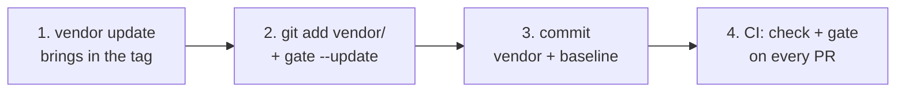
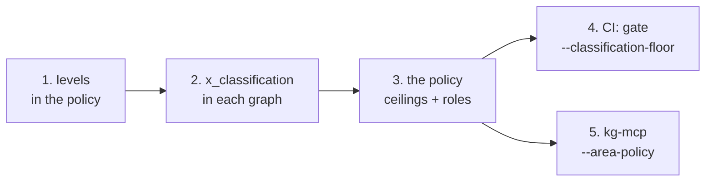

# 6. Adoption and CI

**English** | [Português (Brasil)](pt-BR/06-adocao-e-ci.md)

[← Tools](05-tools.md) · [Index](README.md) · [Conformance and readers →](07-conformance-and-readers.md)

This chapter is the map. The full guide, with every edge case, is [`ADOPTING.md`](../../ADOPTING.md).

## The four-step path



Run this at the root of your repository, with Python 3.12 or later (the floor since 4.35.0; CI runs 3.12, 3.14 and 3.15, and the optional
`vector` extra stops at 3.14 until `onnxruntime` ships for 3.15):

```bash
# 1. bring in the release, by tag, from the public repository
git clone https://github.com/marciocar/kg-ssot ../kg-ssot
python3 -I -B ../kg-ssot/tools/kg_vendor.py update --tag kg-ssot-v4.54.0 --dest vendor/kg-ssot

# 2. the dependencies in a venv, then the baseline (the gate only measures tracked files: git add first)
python3 -m venv .venv && .venv/bin/pip install --require-hashes -r vendor/kg-ssot/tools/requirements.txt
echo .venv/ >> .gitignore
git add vendor/kg-ssot .gitignore docs/          # and your .kg.yaml files, wherever they live
.venv/bin/python3 -I -B vendor/kg-ssot/tools/kg_gate.py --update

# 3. commit the vendor, with its stamp, and the baseline
git add .kg-ssot/gate && git commit -m "adopt the KG-SSOT contract"
```

Graphs that already fail become inherited debt, named by path. Step 4 is CI, on every PR. The full GitHub Actions
workflow is in section 3 of [`ADOPTING.md`](../../ADOPTING.md#3-the-ci-step), the CI step. The step itself is:

```yaml
- name: KG-SSOT contract (intact vendor + per-graph gate)
  run: |
    pip install --require-hashes -r vendor/kg-ssot/tools/requirements.txt
    python3 -I -B vendor/kg-ssot/tools/kg_vendor.py check --dest vendor/kg-ssot
    python3 -I -B vendor/kg-ssot/tools/kg_gate.py
```

## What the gate guarantees

- No **new** graph gets in while it fails MUST.
- No inherited graph gains a MUST code it did not have.
- The SHOULD debt, by code, does not go up.
- A contract change shows up in the PR: the baseline records the name and the sha256 of the schemas.

Fixing one graph does not make up for breaking another: the gate compares MUST graph by graph.

The gate measures only `.kg.yaml` files. A `.kg.json` file in the repository stays outside it. If you want CI to
check those files, run `kg_validate.py` on them in a step of its own.

## Output language in CI

Since 4.18.0, the tools print human output in English by default. They print it in Brazilian Portuguese when
`KG_SSOT_LANG=pt-BR` is set or the locale is `pt_BR`. The tools read the language in gettext order: `KG_SSOT_LANG`,
`LANGUAGE`, `LC_ALL`, `LC_MESSAGES`, `LANG`. The first variable that is set decides; an empty one is skipped. `C`,
`POSIX`, and a language with no catalog mean English.

Base the decision on the return code, never on the text. The gate returns rc 0 when nothing got worse, rc 1 when
something got worse, and rc 2 on broken input. Here is a failing gate in English, after a new graph that
fails MUST entered the PR (rc 1):

```text
✗ WORSE  docs/new.kg.yaml fails MUST: form.required.node.label
· 3 graphs; 1 pass MUST; 1 in the inherited debt
  MUST   docs/legacy.kg.yaml (inherited): form.required.node.plane
  MUST   docs/new.kg.yaml (new): form.required.node.label
```

With `KG_SSOT_LANG=pt-BR`, the same run prints `✗ PIOROU` in place of `✗ WORSE`. If a CI step searches the output
for text (`✗ WORSE` or `GATE BROKEN` from the gate, `PASS` or `BROKEN INPUT` from `kg_validate.py`), set
`KG_SSOT_LANG` in that step or match both languages. Data does not change language: the JSON keys, the codes, and
the place in a verdict (`nó X`, `aresta #n`) stay the same; only the `message` and `hint` text follows the language.

## Update the tag

Do it all in one PR:

1. Run `kg_vendor.py update` with the new tag. From inside the vendor, pass
   `--source https://github.com/marciocar/kg-ssot`.
2. Run `git add vendor/kg-ssot`.
3. Run `kg_vendor.py check --dest vendor/kg-ssot --index` to verify what the commit will carry. If you come from a
   tag older than 4.8.1, run `update` twice: the old kit does not write the vendor's `.gitattributes`, and the 4.8.1
   kit does.
4. Run `kg_gate.py` to see the difference.
5. Run `kg_gate.py --update` to record the new identity.

If a minor version brings a SHOULD warning that your corpus already had, the debt goes up by design. In that case,
run `--update` with `--accept-regression "<reason>"`.

## Bench a commit before its tag (since 4.24)

To test what is about to become a release, before the tag exists, bring a commit with
`kg_vendor.py update --ref <commit> --source <clone or URL>`. You need a repository where that commit is reachable:
the public mirror carries only tagged commits, so this is for whoever can reach the branch (a clone of the product,
a fork, a CI that checks out the PR). It takes the tree of that commit with whatever
`spec/release.json` it has (the version there may still be the previous one, which `--tag` would refuse as a
mislabeled release). The stamp says `unreleased` in place of the tag and keeps the commit. `kg_vendor.py check`
then fails with `UNRELEASED VENDOR` unless you pass `--allow-unreleased`, so a bench vendor never passes for a
release in your CI. The same goes for `kg_gate.py`, which also fails on a bench vendor without
`--allow-unreleased` and never writes the baseline from one: keep the option in the bench command, never in the CI
that guards your releases. When the tag comes out, `update --tag` replaces it without `--force`.

## Move up a major version (v3 → v4)

v4 fails what v3 only warned about. You move up by the **ramp**: the graphs that start to fail enter the baseline
as inherited debt, and from then on the debt only shrinks. There is no date trick in the schema, and you do not
fix the whole corpus at once. The step-by-step guide, with the commands, is in section 5 of
[`ADOPTING.md`](../../ADOPTING.md#5-from-v3-to-v4), from v3 to v4.

## Environment note

On systems with PEP 668 (Ubuntu 24.04 and later), `pip install` outside a venv is refused. Use a venv and run the
kit with its Python. On GitHub Actions with `actions/setup-python`, `pip install` works directly.

## In an app

KG-SSOT holds **knowledge about the product**: decisions, business rules, claims, and the evidence for each one.
It is not a runtime database. A user's progress, points, and streak stay in the app's database. What goes into the
graph is, for example, "the streak resets after a day with no entry," with the source of the decision, the date it
was verified, and a `TRACES_TO` edge to the code or test that implements it. The recipe is in
[chapter 8](08-recipes.md#a-business-rule-linked-to-code), "A business rule linked to code."

- **In CI:** the path above works for any repository, in any language. The gate only needs Python in CI.
- **At runtime, in Python, through the package:** since 4.9.0, the kit also ships on PyPI as `kg-ssot`
  (`pip install kg-ssot`). The modules live in `kg_ssot`, and the package installs the commands `kg-validate`,
  `kg-conformance`, `kg-gate`, `kg-store`, `kg-query`, `kg-diff`, `kg-mcp`, and `kg-prov-export`. The contract and
  the suite travel inside the package:

  ```python
  from kg_ssot import kg_store
  store = kg_store.GitStore("/var/lib/my-app/graphs", init=True)   # outside the app's repository
  ```

  The package is the path for the app. For the **gate in CI**, vendoring by tag is still the recommended channel,
  because the contract that judges the graph stays in the repository's diff.
- **At runtime, in Python, through the vendor:** put `vendor/kg-ssot/tools` on `sys.path` and run without writing
  bytecode, so the vendor `check` stays intact:

  ```python
  import sys
  sys.dont_write_bytecode = True                    # or PYTHONDONTWRITEBYTECODE=1 in the environment
  sys.path.insert(0, "vendor/kg-ssot/tools")
  import kg_store                                    # the store that only writes what the contract approves
  store = kg_store.GitStore("/var/lib/my-app/graphs", init=True)   # outside the app's repository
  ```

  Keep the store root **outside** the app's repository. Inside a git repository, `DiskStore` and `VersionedStore`
  refuse the root. `GitStore` with its root at the repository itself commits on whatever branch is checked out,
  outside the PR, and in a subfolder of the repository it creates a nested git repository.
- **In JavaScript (Node, React Native, Expo):** since 4.9.0, the JS reader ships on npm as `kg-ssot`
  (`npm install kg-ssot`). Its entry point imports nothing from Node, and the contract validator comes precompiled,
  with no `new Function` and no `eval`, so it runs on Hermes. `verdict(text, { format })` returns the MUST verdict
  with the suite's codes, and the `kg-ssot-validate` command judges files. Since 4.10.0, it also measures SHOULD
  warnings, with the same codes as the reference reader in every suite case. Line numbers and hints stay with the
  Python reference reader.
- **In an MCP client, such as Claude Desktop:** since 4.9.0, the reference MCP server also ships as an MCP Bundle
  (`kg-ssot-<version>.mcpb`). It is attached to the tag's release in the public repository after the `kg-ssot`
  package of the same version is on PyPI, because the bundle installs the package from there. During install, the
  client asks for the store directory and whether the server is read-only, and it installs the package with `uv` on
  your machine. `uv` creates the environment inside the extension folder, locked by a `uv.lock` with the hash of
  every dependency. The bundle carries GitHub's provenance attestation
  (`gh attestation verify kg-ssot-<version>.mcpb --repo marciocar/kg-ssot`) and is listed in the official MCP
  Registry as `io.github.marciocar/kg-ssot`. The store is the versioned one: every write is recorded, and
  `kg_history` shows it. A folder inside a git repository uses git, in a nested repository (the outer repository
  then sees it as an untracked folder). When the folder does not open, the server starts with judging only and
  tells the model why, and the model reports it in the chat (since 4.9.1; in 4.9.0 the reason went only to the log).
  It runs on macOS, Linux, and Windows. On Windows, the store runs since 4.9.1 (in 4.9.0 it did not open there),
  with the path protection described in [chapter 5](05-tools.md). The server runs locally, over stdio, and talks
  to no external service.
- **In another language:** there is no ready-made reader beyond Python and JavaScript. Validate through the CLI
  (`kg_validate.py --format json` returns the JSON verdict of `spec/verdict.schema.json`) or through a model, with
  the MCP server (`kg_mcp.py`). Your own reader proves it agrees with the contract by passing the suite
  ([chapter 7](07-conformance-and-readers.md)).

## Classify by sensitivity, end to end

This section takes one organization from "some graphs are sensitive" to a repository that refuses them and a server
that hides them from the wrong reader. Chapters 3 and 5 describe each piece on its own; here they go together, in the
order you set them up. One policy file drives both ends: the gate reads it in CI, and the `kg-mcp` reads it when it
serves. A committed digest of that file, pinned at both ends, makes sure they read the same one.



### 1. Choose the levels

Write the levels of your organization in order, from the least to the most sensitive, each a slug (lowercase letters,
digits, and hyphens). The contract fixes only the shape; the names and the order are yours. Four levels are enough for
most teams:

| Level | Who may read it, in this example |
|---|---|
| `public` | anyone, including a public repository |
| `internal` | everyone in the company |
| `confidential` | the compliance area and its auditors |
| `restricted` | the compliance officers only |

Also choose the `default_level`, the level of a graph that does not declare one. The safe choice is a level that the
public repository does not accept, so a graph someone forgot to mark stops at the gate instead of going out. The
example below uses `confidential`, the first level the canonical area refuses.

### 2. Mark each graph

Put the level in the `meta` of each graph, never on a node:

```yaml
meta:
  schema_version: "1"
  id: payroll-2026
  x_classification: restricted
```

The unit is the graph. A node more sensitive than its graph goes to a graph of its own, with the level in that graph's
`meta` ([chapter 3](03-format.md)): see "Separate the sensitive node" below. `kg_validate.py` warns when the level is not a slug
(`form.pattern.meta.x_classification`), when it is not text (`form.type.meta.x_classification`), and when it sits on a
node (`form.misplaced.node.x_classification`). These are SHOULD warnings: the graph still passes. The floor of step 4
treats a value outside `levels` as unknown and fails it. The `kg-mcp` does the same in every shared area, because
each one has a ceiling (step 3).

#### Separate the sensitive node

When one node of a graph is more sensitive than the rest, move it, with the edges that only it needs, to a graph of
its own at the higher level. The graphs then cite each other in one direction only, from higher to lower:

```yaml
# docs/payroll-2027.kg.yaml, restricted: it may point at the internal graph it builds on
meta:
  schema_version: "1"
  id: payroll-2027
  x_classification: restricted
external_edges:
  - from: D_SALARY_CUT_2027
    to: "docs/team-plan.kg.yaml#Q_HEADCOUNT_2027"
    edge_type: TRACES_TO
```

The `internal` graph keeps no edge, `trace`, or `provenance` that names the `restricted` one: a descriptive id is
already content. `kg_gate.py --classification-cites` (step 4) fails the graph that does it, naming both files and
levels and never the id. Two things stay out, by design: a graph that keeps both levels in the same file has no
label by node (the node is served with its graph), and an id written in free text is not read (see "Free text is not
cut" below).

### 3. Write the policy

The policy is one JSON file, written by the operator and kept outside the store root of the `kg-mcp`. It names the
shared areas (the canonical one, `c-<name>`, read by everyone, and the groups, `g-<name>`, read by their members), the
levels, the ceiling of each area, and the roles:

```json
{"schema_version": 1, "canonical": "c-company",
 "groups": {"g-compliance": ["dpo@x.org"]},
 "levels": ["public", "internal", "confidential", "restricted"],
 "ceilings": {"c-company": "internal", "g-compliance": "restricted"},
 "default_level": "confidential",
 "roles": {"auditor": {"read": ["g-compliance"], "write": [], "ceilings": {"g-compliance": "confidential"}},
           "officer": {"read": ["g-compliance"]}},
 "members": {"aud@x.org": ["auditor"], "off@x.org": ["officer"]}}
```

- `levels`, `ceilings`, and `default_level` come together. A ceiling is the highest level an area serves. Here a
  graph with no level counts as `confidential`: the floor refuses it in the repository of `c-company`, the server does
  not serve it there, and in `g-compliance` the auditor still reads it. **Every shared area has a ceiling:** with
  `levels`, the canonical area and each group must be keys of `ceilings`, or the policy is invalid (deny by default).
  The server does not start with it and the gate stops with `GATE BROKEN` (rc 2), with an error such as
  `ceilings: with levels, every shared area has a ceiling; without one: g-board`, which names each area without one, in
  alphabetical order. For an area that should serve every level you know, give it the last of `levels`: an unknown level
  stays hidden there too.
- A role reads areas (`read`), may lower the ceiling of an area it reads (`ceilings`, never above the area's own and
  never on the canonical area), and writes only in the identity's own area, if at all (`write`: `[]` or `["own"]`).
- Access is the union of the grants, and in the same area the higher ceiling wins. Here `aud@x.org` reads
  `g-compliance` up to `confidential`; `off@x.org` and `dpo@x.org` (a member of the group) read it up to `restricted`.
- The file is read strictly. A repeated key, an unknown level, a shared area without a ceiling, a role ceiling above
  the area's, or a member who cites a role that does not exist makes it invalid, and the server does not start with it
  ([chapter 5](05-tools.md) lists every rule).

Keep the file in a private place that your CI and your server can both read, and pass the same file to both. The
examples below call its path `$KG_AREA_POLICY`.

**Pin its digest.** Nothing else checks that the CI and the server got the same file: a copy with another
`default_level` would make the same graph fail the floor and be served, or the other way round. So commit the digest
of the policy in the repository that the floor guards, and pin it at both ends (steps 4 and 5):

```bash
mkdir -p .kg-ssot
python3 -I vendor/kg-ssot/tools/kg_policy.py digest "$KG_AREA_POLICY" > .kg-ssot/area-policy.digest
git add .kg-ssot/area-policy.digest
```

The digest ignores formatting and the order of things whose order means nothing, and changes with any change that
matters, the order of `levels` included ([chapter 5](05-tools.md), "Pin the policy"). A change of policy is then a
pull request that changes the digest, reviewed like any other change of access. With the package instead of a vendor,
run `python3 -m kg_ssot.kg_policy digest "$KG_AREA_POLICY"`. Both ends must run the same release, because a release
that changes the normalization changes the digest of the same file (chapter 5, "Pin the policy").

The digest does not reveal the policy, but it confirms a guess: someone who knows its likely shape and has a list of
your staff can try member lists offline until one matches. If who belongs to a group is itself sensitive and the
repository is public, keep the value in a CI variable instead of a committed file, and give the server the same value
in a local file outside the store root (step 5).

**Changing the policy.** The change has a loop in it: the pull request that commits the new digest runs the floor
with the secret, which still holds the old policy, so it stops with rc 2; and if you update the secret first, every
other open pull request stops with rc 2 until the new digest is in `main`. The recommended order: open the pull
request with the new digest, update the secret and merge that pull request right after its floor passes, and accept
the short window in which the floor of other pull requests fails closed. They pass again on a re-run once the digest
is in `main` (the merge ref of a pull request takes it; a branch checked out without the merge ref needs a rebase).
Then restart the server with the new file and pin (step 5).

### 4. Turn on the floor in CI

The floor is the first level a repository must never hold. A repository whose graphs are served as `c-company`, whose
ceiling is `internal`, runs the floor at `confidential`. Nothing checks that choice for you: pick the floor one level
above the ceiling of the area the repository feeds.

**What the floor reads.** Every `.kg.yaml` and `.kg.json` that git tracks. The default excludes of the ratchet do not
apply here: your fixtures, `docs/materials/`, and the vendor are all read ([chapter 5](05-tools.md), "A classification
floor"). Before you turn the floor on, mark every graph the repository already has, because with the `default_level`
above a graph without the key counts as `confidential` and fails. Leave out, with `--exclude`, only what is not data of
yours: the vendor, and your own test fixtures (`--exclude 'tests/fixtures/*'`, for example).

The vendor of the full release holds the hundreds of graphs of the conformance suite, almost all without
`x_classification`. Under this policy they get the `default_level` and fail, and a few also carry levels the policy
does not know. That is why the step below excludes `vendor/kg-ssot/*`. The `gate` profile brings no fixture, so with it
you can drop that exclude. An excluded path is not judged at all: a sensitive graph someone puts under
`vendor/kg-ssot/` passes the floor unseen, so keep the exclude to the vendor folder and let `kg_vendor.py check` (which
fails on any file the stamp does not list) guard what is inside it.

**A step of its own.** Run the floor in a step after the contract gate you already have (step 4 of the four-step path,
at the top of this chapter), not inside it. The floor runs the gate again, so the baseline must already be committed
(`.kg-ssot/gate`, from `kg_gate.py --update`); without it the gate stops with rc 2. Keep the policy in a CI secret and
write it to a file in the step:

```yaml
- name: KG-SSOT classification floor
  if: ${{ !cancelled() }}
  env:
    KG_AREA_POLICY_JSON: ${{ secrets.KG_AREA_POLICY }}
  run: |
    printf '%s' "$KG_AREA_POLICY_JSON" > "$RUNNER_TEMP/area-policy.json"
    python3 -I -B vendor/kg-ssot/tools/kg_gate.py --classification-floor confidential \
      --area-policy "$RUNNER_TEMP/area-policy.json" --area-policy-digest @.kg-ssot/area-policy.digest \
      --exclude 'vendor/kg-ssot/*'
```

Add `--classification-cites` to the same command to also fail a lower graph that cites a higher one (the separated
node of step 2); it reads the same policy and needs nothing else ([chapter 5](05-tools.md), "Citations between
levels"). Add `--classification-downgrade --base origin/main` too, to fail a drop of the level without its trail
(step 7); it needs the history of the branch (`fetch-depth: 0` in the checkout).

With `--area-policy-digest`, a secret that holds another policy than the committed digest stops the gate with
`GATE BROKEN` (rc 2) before it judges anything. The message names no digest, since the log of a public repository is
public; compare locally with `kg_policy.py digest`.

A pull request from a fork does not receive the secret: the file comes out empty, the policy is invalid, and the gate
stops with `GATE BROKEN` (rc 2) before it judges anything. That fails closed. Kept in its own step, it costs that PR
only the floor: the contract step, which needs no secret, still gives its verdict. A maintainer then runs the floor for
that PR.

With two graphs that must not be there and one that no one marked, the floor step fails (rc 1):

```text
· 4 graphs; 4 pass MUST; 0 in the inherited debt
  SHOULD form.pattern.meta.x_classification: 1 graph
✗ classification floor: docs/payroll.kg.yaml is at restricted, at or above confidential
✗ classification floor: docs/pricing.kg.yaml is at confidential, at or above confidential
✗ classification floor: docs/vendor-contract.kg.yaml has an unknown level (it is not UTF-8, it does not parse, its meta is not a map, or its x_classification is not one of the levels)
· --classification-floor confidential: 4 graph(s) checked, 3 at or above the floor or with an unknown level
```

`vendor-contract.kg.yaml` says `Confidential`, with a capital letter: that is not one of `levels`, so its level is
unknown and it fails. `pricing.kg.yaml` has no key, so it gets the `default_level`, `confidential`, and fails too. A
missing or invalid policy, a level the policy does not have, and one option without the other are broken input (rc 2),
never a silent pass.

In CI the gate blocks the merge, not the data: the commit already exists on the branch. The floor judges only the tree
of the checkout (and, with `--touched`, the git index against the base). A branch with one commit that adds a
`restricted` graph and another that deletes it passes in both modes, but the blob stays in the branch's history, and
a merge commit or a rebase brings it into `main`. Two things keep it out of `main`: a squash merge, which takes only the
final tree, and the same check with `--touched HEAD` in a pre-commit hook, which stops the commit before it exists
([chapter 5](05-tools.md), "A classification floor"). Once the blob is in `main`, removing it means rewriting the
history.

### 5. Serve with the kg-mcp, under the same policy

The `kg-mcp` applies the ceiling in its "behind a proxy" profile, over HTTP, where each request carries the identity
of the reader. Whoever holds the shared secret can claim any identity, so the proxy in front of the server must
authenticate the user and set the identity header itself, replacing whatever the client sent, and the secret never
reaches an end client ([chapter 5](05-tools.md), "The trust model"). Each shared area is a directory under `--root`,
named after the area. The server writes only in each identity's own area; the operator fills the shared ones, for
example with a clone of the repository from step 4 as `c-company`.

This step needs the server, which the `gate` profile of the vendor does not bring (it has neither `kg_mcp.py` nor
`kg_store.py`). Vendor the full release, or install the package (`pip install kg-ssot`, which gives the `kg-mcp`
command), on the machine that serves:

```bash
export KG_MCP_SECRET=...   # the shared secret that the proxy sends in X-Api-Key
kg-mcp --root /srv/kg-areas --backend git --http 8765 \
  --identity-header X-User-Email --secret-env KG_MCP_SECRET --area-policy "$KG_AREA_POLICY" \
  --area-policy-digest @/srv/kg-areas/c-company/.kg-ssot/area-policy.digest
```

The pin is the file committed in step 3, read here from the clone of the repository that the server serves as
`c-company`. If you kept the value out of the repository (step 3), write it to a local file outside `--root` (say
`/etc/kg-mcp/area-policy.digest`, readable only by the service) and pass `@` with that path; do not pass the value
itself on the command line, where `ps` shows it to every user of the machine. With a policy of another digest the server does not start (rc 2); a policy changed to another digest
while it runs closes reading, as an invalid policy does, once the server sees the change: it rereads the file when its
modification time, size, or inode changes, so a copy that keeps all three (`cp -p` over a file of the same size,
`touch -r`) is not seen until the next change or a restart. The pin is read once, at startup: to change the policy,
merge the new digest, update the file and the clone, and restart; reading stays closed in between.

The server listens on `127.0.0.1` by default, which serves a proxy on the same machine. A proxy on another machine
needs `--host` with an address it can reach and `--allow-remote`, on a private network, with TLS at the proxy.

With the policy above and a graph at each level in `g-compliance`, each audience gets this:

| Graph in `g-compliance` | `aud@x.org` (auditor) | `off@x.org` (officer) | `dpo@x.org` (in the group, no role) | outside the group, no role |
|---|---|---|---|---|
| `internal` | yes | yes | yes | no |
| `confidential`, or no key | yes | yes | yes | no |
| `restricted` | no | yes | yes | no |
| a level not in `levels` | no | no | no | no |

The last row holds in every shared area: each one has a ceiling, and a graph whose level the ceiling cannot place is
never served.

A graph the reader may not see leaves `kg_list`, `kg_get`, `kg_history`, `kg_query`, and `kg_terms`, and a request for
it gets the same answer as a graph that does not exist. An edge or a pointer from a visible graph to it is cut whole,
with no id, no file, and no count: the answers are the same as in a world where the hidden graph never existed.

The ceiling is not applied anywhere else. The `kg-mcp` over stdio, or with a single `--root` store, serves every graph
it has, and `--area-policy` without `--identity-header` is refused (rc 2). The command-line readers (`kg_query.py`,
`kg_trace.py`, `kg_diff.py`, `kg_prov_export.py`, `kg_audit.py`) read every graph they are given.

### 6. What the audit package does and does not do

`kg_audit.py` builds the audit package by question: one row per questionnaire item, with the answer, the verdict, the
dated evidence, and the gaps. It does not read `x_classification`, and it has no option for a policy or an audience.
Run over a corpus, it exports every item it finds, those of `restricted` graphs too, and the package goes to whoever
you send it to. So build the package for an audience from the graphs that audience may read: pass the files
explicitly, or leave the others out with `--exclude`, and read the package before you send it.

### 7. Lower a level with a trail

A level that goes down is a change of access: more people will read the graph. Treat it as one. Write the drop as the
last entry of `meta.x_downgrade` ([chapter 3](03-format.md)), in the same change that lowers `x_classification`, with
the reason, the person who approves (by e-mail), and the reference of the approval:

```yaml
meta:
  id: payroll-2026
  x_classification: internal
  x_downgrade:
    - from: restricted
      to: internal
      reason: "the 2026 payroll was published in the annual report"
      approved_by: "dpo@example.org"
      ref: "https://example.org/acme/kg/pull/42"
      date: "2026-11-16"
```

`kg_gate.py --classification-downgrade` (step 4, and [chapter 5](05-tools.md), "A downgrade asks for a trail")
compares each graph with the base, pairs a graph that was renamed, moved over another path, or deleted and recreated
(by its `meta.id` and by the rename git detects, rewrites included), and fails the drop without that entry, an entry
that does not match the drop or was already there, a trail of the base that was not kept, and an entry whose
`approved_by` is an author or committer of the change of the level. Removing the key counts as a drop to the `default_level`.

The gate checks the trail, not the person. Anyone who writes the graph can write a name in `approved_by`, and the gate
runs offline, so it never asks the forge who approved. The lock is the review of the pull request: protect `main`,
require an approving review, and put the graphs and the policy in `CODEOWNERS`, so the approval comes from someone the
forge authenticates and who owns the data. The trail then says why and who, inside the graph, for anyone who reads it
later.

### Who reads through what (the declared rule)

The ceiling holds only on one path, so the rule of this design says which reader uses which path:

- **A reader who is not a developer reads only through the `kg-mcp` over HTTP, behind an authenticating proxy**
  (step 5). The identity is the one the proxy sets, from a login with a verified e-mail, never one the client sends.
  This is the only path that applies the ceiling, the roles, and the cut of hidden graphs.
- **The other paths are for developers only, and stay out of reach of a business role.** The command-line tools
  (`kg_query.py`, `kg_trace.py`, `kg_diff.py`, `kg_prov_export.py`), the audit package (`kg_audit.py`), and the
  `kg-mcp` over stdio or with a single store (the MCP Bundle in a desktop client included) read every graph they are
  given, at every level. Give them only to whoever may already read the whole repository.

Giving these tools a ceiling of their own is a later improvement, pulled by demand: nothing in this release applies one.

### Out of the first version, and what brings each back

Three choices are left out of this design on purpose, each with the event that reopens it:

- **A sensitivity label per node.** The level stays per graph, and the sensitive node goes to a graph of its own
  (step 2, "Separate the sensitive node"). It reopens only if a repeated measurement, with its criterion registered
  before the sample, meets both of the conditions registered for it; the result is reported whether it meets them or
  not.
- **A deny per person, and precedence between roles.** Today a grant only adds: the highest ceiling a person reaches
  wins, and nothing takes a level away from one person (see "A role ceiling only restricts…" below). It reopens when
  the first adopter needs it.
- **The purpose of the processing (as in data protection law such as the LGPD).** It is an open question of its own.
  Its base is the retention the contract already has: `retain_for` on a node and, for the whole graph, `x_dispose_by`,
  `x_dispose_basis`, and `x_hold` ([chapter 3](03-format.md)). Its limit is stated: the git history keeps every version
  of a graph, so disposing of the file does not remove the old versions; that takes rewriting the history.

### What is not covered yet

Each item says how it is known. **Measured** means a test exercises it against this release and passes while the gap
exists: the test is `tools/test_classification_e2e.py`, in the kg-ssot repository, outside the release, and the
docstring of each test starts with the title of the gap it measures, as written below. **Stated** means it is read from
the code or already declared in chapter 5, with no test of its own there.

- **The audit package has no audience** (measured). `kg_audit.py` exports the questions and answers of a `restricted`
  graph that the `kg-mcp` hides from the auditor (step 6).
- **No label by node, by design** (measured, in the test that covers the separation). The level applies to the whole
  graph, and the gap "No redaction node by node" is covered by the separation of step 2 with
  `--classification-cites`. What stays out: a node with its own `x_classification` inside a lower graph is still served
  with that graph (the reader only warns `form.misplaced.node.x_classification`, and the floor does not see it), and a
  citation to a graph of another repository is not judged by its level (see the next item).
- **What the citation check does not judge** (measured in the gate's tests). `--classification-cites` judges a citation
  by the graphs this repository tracks: it resolves each value through the resolver of `kg_trace.py` and also looks in
  it for the path of each graph of the index, with a path boundary (chapter 5, "The scan of the value"). Every URL, an
  absolute path, and a `private-cite:` marker are counted and pass unless a graph of the index is found in them; a
  relative path to a graph of another repository or area does not resolve here and fails. Prose that names no graph of
  the index is counted as prose and passes. A citation of an old revision (`@rev`, `rev:path`) is judged by the level
  the graph has today. Fields outside the list of chapter 5 are not read: `sealed_by`, `owner`, the keys of a map (only
  its values are read), a percent-encoded path (`%2F`), and a link whose name has no `.kg.` in it (a value that does not
  mention `.kg.yaml`, `.kg.yml`, or `.kg.json` is not a citation). Free text (`label`, `narrative`, `verified_against`,
  other `x_` fields) and a graph of another repository stay out. To cite another area, use a URL or the `private-cite:`
  marker.
- **What the scan of the value does not see** (stated, from the code and the review of the gate; the corpus of this
  repository and of the framework gave no case). A percent-encoded path (`docs%2Fa.kg.yaml`); a path not normalized
  inside prose (`docs/./a.kg.yaml`, `docs//a.kg.yaml`, `x/../docs/a.kg.yaml`, `../docs/a.kg.yaml` from a deeper folder);
  a zero-width space inside a path and fullwidth characters. In the other direction, the fail-closed rule can fail a
  value that only looks like a path to a graph (`notes.kg.yaml.bak`, a query such as `?f=docs/a.kg.yaml` after a path
  that does not resolve): in that case, fix the value or leave the graph out with `--exclude`.
- **A case-insensitive disk in the pre-commit hook** (stated, from the code). The `trace` is resolved on the disk, as
  `kg_trace.py check` resolves it. On a file system that does not tell case apart (macOS, Windows by default),
  `Docs/Payroll.KG.yaml` opens `docs/payroll.kg.yaml`, and the hook passes a citation in the wrong case without
  judging it; the CI on Linux reads it as a path that does not exist and fails. The other fields are resolved by the
  git index, which tells case apart everywhere.
- **A change of the policy alone is not judged by the hook** (stated, from the code). With `--touched`, the floor and
  the citation check judge only graphs and pairs that changed; a new order of `levels` or another `default_level` in
  the policy changes no graph. The CI run without `--touched` reads every graph and covers it.
- **Free text is not cut** (measured for `label`, `narrative`, an `x_` field, and a commit message in `kg_history`). An
  edge to a hidden graph is cut, but an id or a path written in free text reaches readers who cannot see the graph it
  names. Do not name a sensitive graph in text that others read.
- **A level that starts too low is not checked** (measured). The floor and the server trust `x_classification`, and
  `--classification-downgrade` covers a drop within the same repository (step 7). A graph that is born with a low
  label, such as the content of a `restricted` graph copied to a new `internal` graph in another repository, has no
  base to compare with: it passes the floor and the downgrade check (rc 0) and is served to someone with no role.
  Nothing compares the label with the content; a content detector, only as a warning that raises the floor, is the
  next step decided.
- **A graph deleted and recreated, diluted, is not paired** (measured in the gate's tests). Deleted and recreated
  under another path and another `meta.id`, with its content diluted below the similarity git asks for, the graph
  has no pair, and its drop passes the downgrade check (rc 0). So does a graph absorbed by another that changes
  little, or moved with `git mv -f` over a similar one. Pairing by node ids was removed because, in a real history, it
  matched 125 of the 150 new graphs by their ids alone; the content detector is the next step (chapter 5).
- **The approver is not authenticated by the gate** (stated, from the code). `--classification-downgrade` fails an
  `approved_by` that names an author of the change of the level, but it cannot tell a real approval from a name
  written by the author; a co-author in a commit trailer is not read either. The review of the pull request, with
  branch protection and `CODEOWNERS`, is the lock (step 7).
- **A graph that enters and leaves within a branch stays in its history.** Measured: the floor judges the tree of the
  checkout and, with `--touched`, the index against the base, so a commit that adds a `restricted` graph and a later
  one that deletes it pass both modes (rc 0), while `git log --all` still finds the blob. Stated (from how git merges,
  not run here): a merge commit or a rebase brings it into `main`, only a squash merge or the pre-commit hook with
  `--touched HEAD` keeps it out, and removing it afterwards means rewriting the history.
- **The same policy is checked only where the digest is pinned** (measured, at the end of the test that covers
  the pin). Without `--area-policy-digest`, each end reads the file it is given and nothing compares them: with
  a different `default_level`, the same graph without the key fails the floor with one policy and passes with the
  other, and the server hides it with one and serves it with the other. Pin the digest at both ends (step 3).
- **Nothing checks the floor against the ceiling** (measured). With the floor at `restricted` in a repository served
  as an area whose ceiling is `internal`, a `confidential` graph gets in (rc 0), and the server then hides it from
  everyone: the floor has to be chosen by hand, one level above the ceiling of the area.
- **An excluded path is not judged** (measured). The `--exclude 'vendor/kg-ssot/*'` of step 4 also lets a sensitive
  graph placed under that folder pass the floor.
- **Only the behind-a-proxy profile applies the ceiling.** Measured: the `kg-mcp` run as a process over stdio, with a
  single store, serves a `restricted` graph; `--area-policy` without `--identity-header` is refused (rc 2);
  `kg_query.py`, `kg_trace.py`, `kg_diff.py`, and `kg_audit.py` read every level. Stated: `kg_prov_export.py` reads
  no level either (from the code), and the MCP Bundle in a desktop client runs that same stdio server (not run in a
  client here).
- **The identity's own area has no ceiling** (measured). Someone who reads only an area with the ceiling `internal`
  writes a `restricted` graph and one with an unknown level in their own area, and both are served back to them. No one
  else reads that area, but the ceiling is not what keeps it apart.
- **The history shows that a more sensitive version existed** (measured; also stated in chapter 5). `kg_history` of a
  visible graph lists every old version, with its `ref` and commit message, those above the ceiling too; their content
  answers like a graph that does not exist.
- **A role ceiling only restricts someone who reads the area through that role alone** (measured; also stated in
  chapter 5, "Limits of roles"). A member of the area's group, or a holder of another role without a ceiling (an
  auditor who is also an officer), reads the area at the higher ceiling whatever their other roles; the server only
  warns the operator on stderr. There is no ceiling per person that no grant can pass (a deny).
- **Time can tell a hidden graph from a missing one** (stated in chapter 5, "Limits of roles"; not measured here). The
  server reads a hidden graph before it refuses it, so a large one takes longer to refuse than a name that does not
  exist.

## Verify a release: provenance and SBOM

Since 4.45.0, every artifact of a release has a software bill of materials (SBOM) in CycloneDX 1.7 JSON, next to the
provenance attestation it already had. The release on GitHub carries one `<artifact>.cdx.json` for the wheel, the
sdist, the npm tarball, the MCP Bundle and the OCI image, and each SBOM is also attested with the CycloneDX predicate:

```sh
gh attestation verify kg-ssot-<version>.mcpb --repo marciocar/kg-ssot                     # provenance
gh attestation verify kg-ssot-<version>.mcpb --repo marciocar/kg-ssot \
  --predicate-type https://cyclonedx.org/bom                                             # the SBOM
gh attestation verify oci://ghcr.io/marciocar/kg-ssot:<version> --repo marciocar/kg-ssot \
  --predicate-type https://cyclonedx.org/bom
```

- **What an SBOM lists:** the dependencies that the artifact declares, read from inside it (the wheel's metadata,
  the npm `package.json`, the bundle's `pyproject.toml` and `uv.lock`). No package embeds third-party code: pip, npm
  or uv installs the dependencies on your side, so they go with `isExternal: true`, with the declared range in
  `versionRange` when there is one. The license, the version the release was tested with
  (`kg-ssot:tested-version`) and the transitive dependencies come from the environment where the suite passed, and
  for npm from the build lockfile. The MCP Bundle SBOM lists every package of its `uv.lock`, with the hash of each
  file. The image SBOM lists the base image by digest, its Debian packages, the Python interpreter and every
  installed Python distribution.
- **How it is made:** `packaging/sbom/sbom.py`, with the Python standard library only, in the release workflow. It
  refuses an artifact that embeds third-party code (`node_modules`, `site-packages`, a wheel inside a package), so
  the SBOM's claim that nothing is bundled is checked on every release.
- **Reporting a vulnerability:** [SECURITY.md](../../SECURITY.md) has the supported versions, the private channel
  (GitHub Private Vulnerability Reporting), the response times, the scope and the disclosure policy.

### Verifying what you vendor (since 4.47.0)

`kg_vendor.py update --tag T --verify-attestation` accepts the tree only if it matches the manifest the release
attested. Each release from 4.47.0 on carries `<tag>.vendor-manifest.json`, with the sha256 of every file, and a GitHub
provenance attestation for it. The update downloads the manifest, verifies the attestation with `gh` (the repository,
the tag and the release workflow that signed it) and compares every file it brought. Any failure gives rc 2 and leaves
the vendor untouched. A `--source` you do not trust cannot change the bytes: only the attested ones pass, and under
this option a local source is read through a bare clone, so its git configuration does not run.

It is optional because it needs `gh`, authentication and the network, and a tag before 4.47.0 has no manifest to check.
The stamp records the verification, and the next update inherits it; `--no-verify-attestation` drops it on purpose.
`kg_vendor.py check` stays offline and still compares only against the stamp. The check runs in the kit that does the
update, so the first move to 4.47.0 from an older kit is unverified: run the same `update --verify-attestation` again
with the new kit to verify it. In a sandbox where the user cache (`.cache` in the home directory) is read-only, the update with `--verify-attestation`
fails because `gh` writes the Sigstore trust root there: run it with `XDG_CACHE_HOME` pointing to a writable directory,
and the verification stays whole. When `gh` reports that no Sigstore verifier could start, `kg_vendor.py` says so: the
verifier did not start, which says nothing about the release, and it names `XDG_CACHE_HOME` (still rc 2, vendor untouched).
