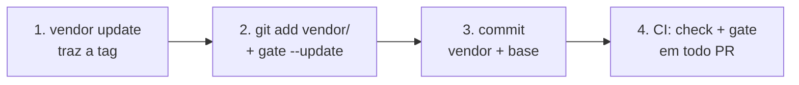
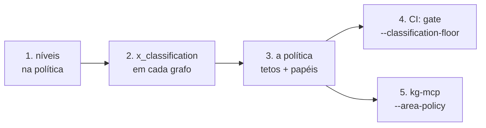

<!-- translation-of: docs/manual/06-adoption-and-ci.md sha256:118ebc1dad04810e -->
# 6. Adoção e CI

[English](../06-adoption-and-ci.md) | **Português (Brasil)**

<sub>Tradução do original em inglês; quando os dois divergirem, vale o inglês.</sub>

[← Ferramentas](05-ferramentas.md) · [Índice](README.md) · [Conformidade e leitores →](07-conformidade-e-leitores.md)

Este capítulo é o mapa. O guia completo, com cada caso de borda, é o [`ADOPTING.pt-BR.md`](../../../ADOPTING.pt-BR.md).

## O caminho em quatro passos



Rode isto na raiz do seu repositório, com Python 3.12 ou mais (o piso desde a 4.35.0; o CI roda 3.12, 3.14 e 3.15, e o extra opcional
`vector` vai até o 3.14 enquanto o `onnxruntime` não sai para o 3.15):

```bash
# 1. trazer a release, por tag, do repositório público
git clone https://github.com/marciocar/kg-ssot ../kg-ssot
python3 -I -B ../kg-ssot/tools/kg_vendor.py update --tag kg-ssot-v4.56.1 --dest vendor/kg-ssot

# 2. as dependências num venv, e a linha de base (o gate só mede arquivo rastreado: git add antes)
python3 -m venv .venv && .venv/bin/pip install --require-hashes -r vendor/kg-ssot/tools/requirements.txt
echo .venv/ >> .gitignore
git add vendor/kg-ssot .gitignore docs/          # e os seus .kg.yaml, onde estiverem
.venv/bin/python3 -I -B vendor/kg-ssot/tools/kg_gate.py --update

# 3. commitar o vendor, com o carimbo, e a base
git add .kg-ssot/gate && git commit -m "adota o contrato KG-SSOT"
```

Os grafos que já reprovam viram dívida herdada, nomeada por caminho. O passo 4 é o CI, em todo PR. O workflow
completo do GitHub Actions está na seção 3 do [`ADOPTING.pt-BR.md`](../../../ADOPTING.pt-BR.md#3-o-passo-de-ci), o passo de CI. O passo
em si é:

```yaml
- name: Contrato KG-SSOT (vendor íntegro + gate por grafo)
  run: |
    pip install --require-hashes -r vendor/kg-ssot/tools/requirements.txt
    python3 -I -B vendor/kg-ssot/tools/kg_vendor.py check --dest vendor/kg-ssot
    python3 -I -B vendor/kg-ssot/tools/kg_gate.py
```

## O que o gate garante

- Nenhum grafo **novo** entra reprovando no MUST.
- Nenhum grafo herdado ganha um código MUST que não tinha.
- A dívida SHOULD, por código, não sobe.
- Uma troca de contrato aparece no PR: a base guarda o nome e o sha256 dos schemas.

Consertar um grafo não compensa quebrar outro: o gate compara o MUST grafo a grafo.

O gate mede os arquivos `.kg.yaml` e `.kg.json` do mesmo jeito: o `.kg.json` rastreado é lido no perfil JSON do
contrato e passa pela mesma linha de base, pelo mesmo `--touched` e pelas mesmas conferências opcionais. Até a 4.56.0
o gate media só o `.kg.yaml`; se você atualiza a partir dali com um `.kg.json` já rastreado, a primeira rodada o
mostra como grafo novo. Se ele passa no MUST e não traz dívida SHOULD, o gate passa e o `--update` o registra. Se ele
sobe a dívida, grave a base com o motivo, `python3 -I -B vendor/kg-ssot/tools/kg_gate.py --update --accept-regression
"<motivo>"`; se ele reprova no MUST, conserte, ou aceite como dívida herdada do mesmo jeito.

## A língua da saída no CI

Desde a 4.18.0, as ferramentas imprimem a saída humana em inglês por padrão. Elas a imprimem em português do Brasil
quando há `KG_SSOT_LANG=pt-BR` ou o locale é `pt_BR`. As ferramentas leem a língua na ordem do gettext:
`KG_SSOT_LANG`, `LANGUAGE`, `LC_ALL`, `LC_MESSAGES`, `LANG`. Decide a primeira variável definida; uma vazia é pulada.
`C`, `POSIX` e uma língua sem catálogo são o inglês.

Decida pelo código de retorno, nunca pelo texto. O gate devolve rc 0 quando nada piorou, rc 1 quando algo piorou e
rc 2 em entrada quebrada. Eis um gate reprovando, em português, depois que entrou no PR um grafo novo que
reprova no MUST (rc 1):

```text
✗ PIOROU  docs/new.kg.yaml falha no MUST: form.required.node.label
· 3 grafos; 1 passam no MUST; 1 na dívida herdada
  MUST   docs/legacy.kg.yaml (herdado): form.required.node.plane
  MUST   docs/new.kg.yaml (novo): form.required.node.label
```

Sem `KG_SSOT_LANG` e com um locale que não é `pt_BR`, a mesma execução imprime `✗ WORSE` no lugar de `✗ PIOROU`. Se
um passo do CI procura texto na saída (`✗ PIOROU` ou `GATE QUEBRADO` do gate, `PASSA` ou `ENTRADA QUEBRADA` do
`kg_validate.py`), fixe `KG_SSOT_LANG` nesse passo ou case as duas línguas. Os dados não mudam de língua: as chaves
do JSON, os códigos e o lugar de um veredito (`nó X`, `aresta #n`) ficam iguais; só o texto de `message` e `hint`
segue a língua.

## Atualizar a tag

Faça tudo num PR só:

1. Rode `kg_vendor.py update` com a tag nova. De dentro do vendor, passe
   `--source https://github.com/marciocar/kg-ssot`.
2. Rode `git add vendor/kg-ssot`.
3. Rode `kg_vendor.py check --dest vendor/kg-ssot --index` para conferir o que o commit vai levar. Se você sai de uma
   tag anterior à 4.8.1, rode o `update` duas vezes: o kit antigo não grava o `.gitattributes` do vendor, e o da
   4.8.1 grava.
4. Rode `kg_gate.py` para ver a diferença.
5. Rode `kg_gate.py --update` para gravar a identidade nova.

Se uma versão menor trouxe um aviso SHOULD que o seu corpus já tinha, a dívida sobe por desenho. Nesse caso, rode o
`--update` com `--accept-regression "<motivo>"`.

## Testar um commit antes da tag (desde a 4.24)

Para testar o que vai virar release, antes de a tag existir, traga um commit com
`kg_vendor.py update --ref <commit> --source <clone ou URL>`. Você precisa de um repositório onde esse commit se
alcança: o espelho público guarda só os commits com tag, então isto é para quem chega à branch (um clone do produto,
um fork, um CI que faz checkout do PR). Ele leva a árvore desse commit com o `spec/release.json`
que ela tiver (a versão ali pode ainda ser a anterior, que o `--tag` recusaria como release mal rotulada). O carimbo
diz `unreleased` no lugar da tag e guarda o commit. O `kg_vendor.py check` então reprova com `VENDOR FORA DE RELEASE`, a
não ser que você passe `--allow-unreleased`, para um vendor de bancada nunca passar por release no seu CI. O mesmo vale
para o `kg_gate.py`, que também reprova o vendor de bancada sem `--allow-unreleased` e nunca grava a base a partir de
um: deixe a opção no comando da bancada, nunca no CI que guarda as suas releases. Quando a tag sair, o `update --tag` o
substitui sem `--force`.

## Subir de uma versão maior (v3 → v4)

O v4 reprova o que o v3 só alertava. A subida é pela **rampa**: os grafos que passam a reprovar entram na base como
dívida herdada, e daí em diante a dívida só encolhe. Não há truque de data no schema, e você não conserta o corpus
inteiro de uma vez. O passo a passo, com os comandos, está na seção 5 do
[`ADOPTING.pt-BR.md`](../../../ADOPTING.pt-BR.md#5-do-v3-para-o-v4), do v3 para o v4.

## Nota de ambiente

Em sistemas com PEP 668 (Ubuntu 24.04 em diante), o `pip install` fora de um venv é recusado. Use um venv e rode o
kit com o Python dele. No GitHub Actions com `actions/setup-python`, o `pip install` funciona direto.

## Num app

O KG-SSOT guarda **conhecimento sobre o produto**: decisões, regras de negócio, afirmações e a evidência de cada uma.
Não é banco de dados de runtime. O progresso, os pontos e a sequência de um usuário continuam no banco do app. O que
vai para o grafo é, por exemplo, "a sequência zera depois de um dia sem registro", com a fonte da decisão, a data em
que foi conferida e uma aresta `TRACES_TO` até o código ou o teste que a implementa. A receita está no
[capítulo 8](08-receitas.md#uma-regra-de-negócio-ligada-ao-código), "Uma regra de negócio ligada ao código".

- **No CI:** o caminho acima vale para qualquer repositório, de qualquer linguagem. O gate só precisa de Python no
  CI.
- **Em tempo de execução, em Python, pelo pacote:** desde a 4.9.0, o kit também sai no PyPI como `kg-ssot`
  (`pip install kg-ssot`). Os módulos ficam em `kg_ssot`, e o pacote instala os comandos `kg-validate`,
  `kg-conformance`, `kg-gate`, `kg-store`, `kg-query`, `kg-diff`, `kg-mcp` e `kg-prov-export`. O contrato e a suíte
  viajam dentro do pacote:

  ```python
  from kg_ssot import kg_store
  store = kg_store.GitStore("/var/lib/meu-app/grafos", init=True)   # fora do repositório do app
  ```

  O pacote é o caminho para o app. Para o **gate no CI**, o vendor por tag continua o canal recomendado, porque o
  contrato que julga o grafo fica no diff do repositório.
- **Em tempo de execução, em Python, pelo vendor:** ponha `vendor/kg-ssot/tools` no `sys.path` e rode sem gravar
  bytecode, para o `check` do vendor seguir íntegro:

  ```python
  import sys
  sys.dont_write_bytecode = True                    # ou PYTHONDONTWRITEBYTECODE=1 no ambiente
  sys.path.insert(0, "vendor/kg-ssot/tools")
  import kg_store                                    # o armazém que só grava o que o contrato aprova
  store = kg_store.GitStore("/var/lib/meu-app/grafos", init=True)   # fora do repositório do app
  ```

  Deixe a raiz do armazém **fora** do repositório do app. Dentro de um repositório git, o `DiskStore` e o
  `VersionedStore` recusam a raiz. O `GitStore` com a raiz no próprio repositório commita no branch em que ele
  estiver, fora do PR, e numa subpasta do repositório cria um repositório git aninhado.
- **Em JavaScript (Node, React Native, Expo):** desde a 4.9.0, o leitor JS sai no npm como `kg-ssot`
  (`npm install kg-ssot`). A entrada dele não importa nada do Node, e o validador do contrato vem pré-compilado, sem
  `new Function` nem `eval`, então roda no Hermes. `verdict(texto, { format })` devolve o veredito MUST com os
  códigos da suíte, e o comando `kg-ssot-validate` julga arquivos. Desde a 4.10.0, ele mede também os avisos SHOULD,
  com os mesmos códigos do leitor de referência em todos os casos da suíte. O número da linha e as dicas ficam com o
  leitor de referência em Python.
- **Num cliente de MCP, como o Claude Desktop:** desde a 4.9.0, o servidor MCP de referência também sai como MCP
  Bundle (`kg-ssot-<versão>.mcpb`). Ele é anexado à release da tag no repositório público depois que o pacote
  `kg-ssot` da mesma versão sai no PyPI, porque o bundle instala o pacote de lá. Na instalação, o cliente pergunta o
  diretório do armazém e se o servidor fica só leitura, e instala o pacote pelo `uv` na sua máquina. O `uv` cria o
  ambiente dentro da pasta da extensão, travado por um `uv.lock` com o hash de cada dependência. O bundle traz a
  atestação de proveniência do GitHub
  (`gh attestation verify kg-ssot-<versão>.mcpb --repo marciocar/kg-ssot`) e aparece no MCP Registry oficial como
  `io.github.marciocar/kg-ssot`. O armazém é o versionado: cada gravação fica registrada, e o `kg_history` a mostra.
  Uma pasta dentro de um repositório git usa o git, num repositório aninhado (o repositório de fora passa a vê-la
  como pasta não rastreada). Quando a pasta não abre, o servidor sobe só com o julgamento e diz o motivo ao modelo,
  que o conta no chat (desde a 4.9.1; na 4.9.0 o motivo ia só para o log). Roda no macOS, no Linux e no Windows. No
  Windows, o armazém roda desde a 4.9.1 (na 4.9.0 ele não abria lá), com a proteção de caminho descrita no
  [capítulo 5](05-ferramentas.md). O servidor roda local, por stdio, e não fala com nenhum serviço externo.
- **Em outra linguagem:** não há leitor pronto além do Python e do JavaScript. Valide pelo CLI
  (`kg_validate.py --format json` devolve o veredito JSON de `spec/verdict.schema.json`) ou por um modelo, com o
  servidor MCP (`kg_mcp.py`). Um leitor próprio prova que concorda com o contrato passando na suíte
  ([capítulo 7](07-conformidade-e-leitores.md)).

## Classificar por sensibilidade, de ponta a ponta

Esta seção leva uma organização de "alguns grafos são sensíveis" a um repositório que os recusa e a um servidor que os
esconde de quem não deve ler. Os capítulos 3 e 5 descrevem cada peça sozinha; aqui elas vão juntas, na ordem em que
você as monta. Um arquivo de política só move as duas pontas: o gate o lê no CI, e o `kg-mcp` o lê quando serve. Um digest commitado desse arquivo, fixado nas duas pontas, garante que elas leem o mesmo.



### 1. Escolher os níveis

Escreva os níveis da organização em ordem, do menos ao mais sensível, cada um um slug (letras minúsculas, dígitos e
hífen). O contrato fixa só a forma; os nomes e a ordem são seus. Quatro níveis bastam para a maioria dos times:

| Nível | Quem pode ler, neste exemplo |
|---|---|
| `public` | qualquer um, inclusive um repositório público |
| `internal` | todos na empresa |
| `confidential` | a área de compliance e os auditores dela |
| `restricted` | só os responsáveis de compliance |

Escolha também o `default_level`, o nível do grafo que não declara nenhum. A escolha segura é um nível que o
repositório público não aceita: o grafo que alguém esqueceu de marcar para no gate em vez de sair. O exemplo abaixo
usa `confidential`, o primeiro nível que a área canônica recusa.

### 2. Marcar cada grafo

Ponha o nível no `meta` de cada grafo, nunca num nó:

```yaml
meta:
  schema_version: "1"
  id: payroll-2026
  x_classification: restricted
```

A unidade é o grafo. O nó mais sensível que o grafo dele vai para um grafo próprio, com o nível no `meta` desse grafo
([capítulo 3](03-formato.md)): veja "Separar o nó sensível" abaixo. O `kg_validate.py` alerta quando o nível não é slug
(`form.pattern.meta.x_classification`), quando não é texto (`form.type.meta.x_classification`) e quando está num nó
(`form.misplaced.node.x_classification`). São avisos SHOULD: o grafo continua passando. O piso do passo 4 trata o
valor fora de `levels` como desconhecido e o reprova. O `kg-mcp` faz o mesmo em toda área compartilhada, porque cada
uma tem teto (passo 3).

#### Separar o nó sensível

Quando um nó de um grafo é mais sensível que o resto, leve-o, com as arestas que só ele usa, para um grafo próprio, no
nível maior. Os grafos então se citam num sentido só, do maior para o menor:

```yaml
# docs/payroll-2027.kg.yaml, restricted: pode apontar para o grafo internal em que se apoia
meta:
  schema_version: "1"
  id: payroll-2027
  x_classification: restricted
external_edges:
  - from: D_SALARY_CUT_2027
    to: "docs/team-plan.kg.yaml#Q_HEADCOUNT_2027"
    edge_type: TRACES_TO
```

O grafo `internal` não guarda aresta, `trace` nem `provenance` que nomeie o `restricted`: um id descritivo já é
conteúdo. O `kg_gate.py --classification-cites` (passo 4) reprova o grafo que o faz, com os dois arquivos e os níveis
e nunca o id. Duas coisas ficam de fora, por desenho: o grafo que guarda os dois níveis no mesmo arquivo não tem rótulo
por nó (o nó é servido com o grafo dele), e o id escrito em texto livre não é lido (veja "O texto livre não é cortado"
abaixo).

### 3. Escrever a política

A política é um arquivo JSON, escrito pelo operador e guardado fora da raiz do armazém do `kg-mcp`. Ele nomeia as
áreas compartilhadas (a canônica, `c-<nome>`, lida por todos, e os grupos, `g-<nome>`, lidos pelos membros), os
níveis, o teto de cada área e os papéis:

```json
{"schema_version": 1, "canonical": "c-company",
 "groups": {"g-compliance": ["dpo@x.org"]},
 "levels": ["public", "internal", "confidential", "restricted"],
 "ceilings": {"c-company": "internal", "g-compliance": "restricted"},
 "default_level": "confidential",
 "roles": {"auditor": {"read": ["g-compliance"], "write": [], "ceilings": {"g-compliance": "confidential"}},
           "officer": {"read": ["g-compliance"]}},
 "members": {"aud@x.org": ["auditor"], "off@x.org": ["officer"]}}
```

- `levels`, `ceilings` e `default_level` vêm juntos. O teto é o nível mais alto que uma área serve. Aqui o grafo sem
  nível conta como `confidential`: o piso o recusa no repositório de `c-company`, o servidor não o serve ali, e em
  `g-compliance` o auditor ainda o lê. **Toda área compartilhada tem teto:** com `levels`, a canônica e cada grupo têm
  de ser chave de `ceilings`, ou a política é inválida (negar por padrão). O servidor não sobe com ela e o gate para com
  `GATE QUEBRADO` (rc 2), com um erro como
  `ceilings: with levels, every shared area has a ceiling; without one: g-board`, que nomeia cada área sem teto, em
  ordem alfabética. Para a área que deve servir todo nível conhecido, dê a ela o último de `levels`: o nível
  desconhecido continua escondido ali.
- Um papel lê áreas (`read`), pode baixar o teto de uma área que lê (`ceilings`, nunca acima do teto da própria área e
  nunca na canônica) e grava só na área da própria identidade, se gravar (`write`: `[]` ou `["own"]`).
- O acesso é a união das concessões, e na mesma área vale o maior teto. Aqui `aud@x.org` lê `g-compliance` até
  `confidential`; `off@x.org` e `dpo@x.org` (membro do grupo) a leem até `restricted`.
- O arquivo é lido de forma estrita. Uma chave repetida, um nível desconhecido, uma área compartilhada sem teto, um
  teto de papel acima do da área ou um membro que cita papel que não existe o tornam inválido, e o servidor não sobe com
  ele (o [capítulo 5](05-ferramentas.md) lista todas as regras).

Guarde o arquivo num lugar privado que o CI e o servidor consigam ler, e passe o mesmo arquivo aos dois. Os exemplos
abaixo chamam o caminho dele de `$KG_AREA_POLICY`.

**Fixe o digest dela.** Nada mais confere que o CI e o servidor receberam o mesmo arquivo: uma cópia com outro
`default_level` faria o mesmo grafo reprovar no piso e ser servido, ou o contrário. Então commite o digest da política
no repositório que o piso guarda, e fixe-o nas duas pontas (passos 4 e 5):

```bash
mkdir -p .kg-ssot
python3 -I vendor/kg-ssot/tools/kg_policy.py digest "$KG_AREA_POLICY" > .kg-ssot/area-policy.digest
git add .kg-ssot/area-policy.digest
```

O digest ignora a formatação e a ordem do que não tem ordem, e muda com qualquer mudança que importa, a ordem de
`levels` inclusive ([capítulo 5](05-ferramentas.md), "Fixar a política"). A troca de política passa a ser um pull
request que muda o digest, revisado como qualquer outra mudança de acesso. Com o pacote no lugar do vendor, rode
`python3 -m kg_ssot.kg_policy digest "$KG_AREA_POLICY"`. As duas pontas têm de rodar a mesma release, porque uma
release que muda a normalização muda o digest do mesmo arquivo (capítulo 5, "Fixar a política").

O digest não revela a política, mas confirma um palpite: quem conhece a forma provável dela e tem uma lista dos seus
funcionários pode tentar listas de membros fora da rede até uma bater. Se quem pertence a um grupo é ele mesmo
sensível e o repositório é público, guarde o valor numa variável do CI em vez de um arquivo commitado, e dê ao
servidor o mesmo valor num arquivo local fora da raiz do armazém (passo 5).

**Trocar a política.** A troca tem um laço: o pull request que commita o digest novo roda o piso com o secret, que
ainda guarda a política antiga, e para com rc 2; e, se você atualizar o secret antes, todo outro pull request aberto
para com rc 2 até o digest novo estar na `main`. A ordem recomendada: abra o pull request com o digest novo, atualize o
secret e faça o merge desse pull request logo que o piso dele passar, aceitando a janela curta em que o piso dos outros
pull requests falha fechado. Eles voltam a passar numa nova execução quando o digest estiver na `main` (o merge ref de
um pull request o traz; uma branch obtida sem o merge ref precisa de rebase). Depois, reinicie o servidor com o arquivo
e o pin novos (passo 5).

### 4. Ligar o piso no CI

O piso é o primeiro nível que um repositório nunca pode guardar. O repositório cujos grafos são servidos como
`c-company`, de teto `internal`, roda o piso em `confidential`. Nada confere essa escolha por você: escolha o piso um
nível acima do teto da área que o repositório alimenta.

**O que o piso lê.** Todo `.kg.yaml` e `.kg.json` que o git rastreia. Os excludes padrão da catraca não valem aqui: as
suas fixtures, o `docs/materials/` e o vendor são lidos ([capítulo 5](05-ferramentas.md), "O piso de classificação").
Antes de ligar o piso, marque todo grafo que o repositório já tem, porque com o `default_level` acima o grafo sem a
chave conta como `confidential` e reprova. Tire com `--exclude` só o que não é dado seu: o vendor e as suas fixtures de
teste (`--exclude 'tests/fixtures/*'`, por exemplo).

O vendor da release inteira guarda as centenas de grafos da suíte de conformidade, quase todos sem `x_classification`.
Sob esta política eles ficam com o `default_level` e reprovam, e alguns ainda trazem níveis que a política não conhece.
Por isso o passo abaixo exclui `vendor/kg-ssot/*`. O perfil `gate` não traz fixture, e com ele você pode tirar esse
exclude. O caminho excluído não é julgado: o grafo sensível que alguém põe sob `vendor/kg-ssot/` passa no piso sem ser
visto. Por isso, restrinja o exclude à pasta do vendor e deixe o `kg_vendor.py check` (que reprova todo arquivo que o
carimbo não lista) guardar o que está nela.

**Um passo próprio.** Rode o piso num passo depois do gate do contrato que você já tem (o passo 4 do caminho em quatro
passos, no começo deste capítulo), não dentro dele. O piso roda o gate de novo, então a linha de base já precisa estar
commitada (`.kg-ssot/gate`, do `kg_gate.py --update`); sem ela, o gate para com rc 2. Guarde a política num secret do
CI e grave-a num arquivo no passo:

```yaml
- name: KG-SSOT classification floor
  if: ${{ !cancelled() }}
  env:
    KG_AREA_POLICY_JSON: ${{ secrets.KG_AREA_POLICY }}
  run: |
    printf '%s' "$KG_AREA_POLICY_JSON" > "$RUNNER_TEMP/area-policy.json"
    python3 -I -B vendor/kg-ssot/tools/kg_gate.py --classification-floor confidential \
      --area-policy "$RUNNER_TEMP/area-policy.json" --area-policy-digest @.kg-ssot/area-policy.digest \
      --exclude 'vendor/kg-ssot/*'
```

Acrescente `--classification-cites` ao mesmo comando para reprovar também o grafo de nível menor que cita um de nível
maior (o nó separado do passo 2); ele lê a mesma política e não precisa de mais nada ([capítulo 5](05-ferramentas.md),
"Citação entre níveis"). Acrescente também `--classification-downgrade --base origin/main`, para reprovar a queda do
nível sem a trilha dela (passo 7); ele precisa do histórico da branch (`fetch-depth: 0` no checkout).

Com `--area-policy-digest`, um secret que guarda outra política que não a do digest commitado para o gate com
`GATE QUEBRADO` (rc 2) antes de julgar qualquer coisa. A mensagem não nomeia digest nenhum, porque o log de um
repositório público é público; compare localmente com o `kg_policy.py digest`.

O pull request de um fork não recebe o secret: o arquivo sai vazio, a política é inválida e o gate para com
`GATE BROKEN` (rc 2) antes de julgar qualquer coisa. Isso falha fechado. Num passo próprio, o PR perde só o piso: o
passo do contrato, que não precisa de secret, continua dando o veredito dele. Um mantenedor roda o piso para esse PR.

Com dois grafos que não podem estar ali e um que ninguém marcou, o passo do piso reprova (rc 1):

```text
· 4 grafos; 4 passam no MUST; 0 na dívida herdada
  SHOULD form.pattern.meta.x_classification: 1 grafo
✗ piso de classificação: docs/payroll.kg.yaml está em restricted, no nível confidential ou acima
✗ piso de classificação: docs/pricing.kg.yaml está em confidential, no nível confidential ou acima
✗ piso de classificação: docs/vendor-contract.kg.yaml tem nível desconhecido (não é UTF-8, não parseia, o meta não é mapa, ou o x_classification não é um dos levels)
· --classification-floor confidential: 4 grafo(s) conferido(s), 3 no piso ou acima, ou com nível desconhecido
```

O `vendor-contract.kg.yaml` diz `Confidential`, com maiúscula: não é um dos `levels`, então o nível dele é
desconhecido e ele reprova. O `pricing.kg.yaml` não tem a chave, fica com o `default_level`, `confidential`, e também
reprova. A política ausente ou inválida, o nível que a política não tem e uma opção sem a outra são entrada quebrada
(rc 2), nunca uma passagem calada.

No CI o gate barra o merge, não o dado: o commit já existe na branch. O piso julga só a árvore do checkout (e, com
`--touched`, o índice do git contra a base). Uma branch com um commit que adiciona um grafo `restricted` e outro que o
apaga passa nos dois modos, mas o blob fica no histórico da branch, e um merge commit ou um rebase o leva à `main`.
Duas coisas o mantêm fora da `main`: o squash merge, que leva só a árvore final, e a mesma conferência com
`--touched HEAD` num hook de pre-commit, que barra o commit antes de ele existir ([capítulo 5](05-ferramentas.md), "O
piso de classificação"). Depois que o blob está na `main`, tirá-lo exige reescrever o histórico.

### 5. Servir pelo kg-mcp, sob a mesma política

O `kg-mcp` aplica o teto no perfil "atrás de proxy", por HTTP, em que cada requisição traz a identidade de quem lê.
Quem tem o segredo compartilhado afirma qualquer identidade, então o proxy na frente do servidor tem de autenticar o
usuário e definir ele mesmo o header de identidade, trocando o que o cliente mandou, e o segredo nunca chega a um
cliente final ([capítulo 5](05-ferramentas.md), "O modelo de confiança"). Cada área compartilhada é um diretório sob
`--root`, com o nome da área. O servidor grava só na área própria de cada identidade; o operador preenche as
compartilhadas, por exemplo com um clone do repositório do passo 4 como `c-company`.

Este passo pede o servidor, que o perfil `gate` do vendor não traz (ele não tem `kg_mcp.py` nem `kg_store.py`).
Vendorize a release inteira, ou instale o pacote (`pip install kg-ssot`, que dá o comando `kg-mcp`), na máquina que
serve:

```bash
export KG_MCP_SECRET=...   # o segredo compartilhado que o proxy manda em X-Api-Key
kg-mcp --root /srv/kg-areas --backend git --http 8765 \
  --identity-header X-User-Email --secret-env KG_MCP_SECRET --area-policy "$KG_AREA_POLICY" \
  --area-policy-digest @/srv/kg-areas/c-company/.kg-ssot/area-policy.digest
```

O pin é o arquivo commitado no passo 3, lido aqui do clone do repositório que o servidor serve como `c-company`.
Se você guardou o valor fora do repositório (passo 3), grave-o num arquivo local fora de `--root` (por exemplo
`/etc/kg-mcp/area-policy.digest`, legível só pelo serviço) e passe `@` com esse caminho; não passe o próprio valor na
linha de comando, onde o `ps` o mostra a todo usuário da máquina.
Com uma política de outro digest o servidor não sobe (rc 2); a política trocada por outro digest com ele de pé
fecha a leitura, como a política inválida, quando o servidor vê a troca: ele relê o arquivo quando a hora de
modificação, o tamanho ou o inode mudam, então uma cópia que guarda os três (`cp -p` sobre um arquivo do mesmo
tamanho, `touch -r`) só é vista na próxima mudança ou num reinício. O pin é lido uma vez, na partida: para trocar a
política, faça o merge do digest novo, atualize o arquivo e o clone e reinicie; a leitura fica fechada no meio.

O servidor escuta em `127.0.0.1` por padrão, o que serve a um proxy na mesma máquina. Um proxy em outra máquina pede
`--host` com um endereço que ele alcance e `--allow-remote`, numa rede privada, com TLS no proxy.

#### Servir só o que foi publicado: uma tag assinada, como serviço

Para quem não é desenvolvedor, sirva a release do repositório, não o clone. Com `--serve-ref` e `--read-only`, cada
área é lida da árvore de uma ref, nunca da árvore de trabalho ([capítulo 5](05-ferramentas.md), "A ref servida"); com
um padrão de tag e `--verify-signers`, só a tag `hub-v<semver>` mais alta com assinatura SSH válida de uma chave do
arquivo `allowed_signers` é servida. Corte a tag assinada (`git -c gpg.format=ssh -c user.signingkey=CHAVE tag -s
hub-v1.4.0 -m ...`) e liste as chaves que podem cortá-la, uma por linha (`release@x.org ssh-ed25519 AAAA...`), num
arquivo fora de `--root`.

No systemd, o `LoadCredential=` entrega os quatro arquivos ao serviço numa pasta privada (`%d` na unit), legível só por
ele, e nenhum deles vai para a linha de comando nem para o ambiente; e o `StateDirectory=` lhe dá o `/var/lib/kg-mcp`
(`%S/kg-mcp`), fora do clone, para o piso de versão do padrão:

```ini
# /etc/systemd/system/kg-mcp.service
[Unit]
Description=kg-mcp, read-only, the signed hub tag
Wants=network-online.target
After=network-online.target

[Service]
User=kg-mcp
StateDirectory=kg-mcp
LoadCredential=area-policy.json:/etc/kg-mcp/area-policy.json
LoadCredential=area-policy.digest:/etc/kg-mcp/area-policy.digest
LoadCredential=secret:/etc/kg-mcp/secret
LoadCredential=allowed_signers:/etc/kg-mcp/allowed_signers
ExecStart=/opt/kg-mcp/bin/kg-mcp --root /srv/kg-areas --backend git --read-only --http 8765 \
  --identity-header X-User-Email --secret-file @%d/secret \
  --area-policy %d/area-policy.json --area-policy-digest @%d/area-policy.digest \
  --serve-ref refs/tags/hub-v* --verify-signers @%d/allowed_signers --serve-state %S/kg-mcp
ReadOnlyPaths=/srv/kg-areas
ProtectSystem=strict
ProtectHome=yes
PrivateTmp=yes
NoNewPrivileges=yes
Restart=on-failure

[Install]
WantedBy=multi-user.target
```

- **As credenciais são uma cópia feita na partida:** com `LoadCredential=`, a mudança nos arquivos de `/etc/kg-mcp/`
  vale no `systemctl restart kg-mcp`, que é também como a política fixada muda (acima). A releitura do segredo e do
  arquivo de signatários serve ao arquivo que o operador troca no lugar, sem o systemd.
- **O servidor não busca nada:** ele pede o git 2.45.1 ou mais novo (ou 2.39.4, 2.40.2, 2.41.1, 2.42.2, 2.43.4,
  2.44.1), provado na partida, o roda sem transporte e sem o lazy fetch do clone parcial, e recusa o clone parcial, o
  raso, os enxertos, os objetos emprestados, a worktree ligada e os links simbólicos em `.git`
  ([capítulo 5](05-ferramentas.md), "O que o clone não pode ser"). Um timer do mesmo usuário traz as tags novas para o
  clone, com
  `git -C /srv/kg-areas/c-company fetch origin 'refs/tags/*:refs/tags/*'`: sem `--prune`, sem `--prune-tags` e sem `+`
  no refspec. Uma tag nova assinada é servida na requisição seguinte; uma tag nova mais alta que não verifica fecha a
  área até ser removida ou trocada, e o servidor não volta para a tag anterior.
- **O rollback, e o que o barra:** quem pode dar push no remoto poderia apagar lá a tag mais alta; com `--prune-tags`
  (ou `--prune` com um refspec de tags) o fetch a apaga aqui também, e sem o piso o padrão serviria a tag anterior,
  assinada e válida, com um conteúdo que foi retirado. O mesmo vale para uma tag movida no remoto e forçada com `+`. O
  fetch acima guarda as tags que já tem, e o `--serve-state` guarda a maior versão servida mesmo que o clone a perca:
  uma versão menor fecha a área, com o motivo no stderr, até que se corte uma tag assinada mais alta. Uma versão
  retirada se desfaz cortando uma nova, mais alta, nunca apagando a tag. O piso é confiança no primeiro uso: a primeira
  partida sem arquivo de estado aceita a maior tag válida que o clone tem, e apagar o arquivo de estado o zera; mantenha
  o `/var/lib/kg-mcp` com o serviço (o `StateDirectory=` o cria com modo 0755, e ninguém mais grava nele) e no backup dele.
- **O dono do clone:** o git recusa um repositório de outro usuário ("dubious ownership"), e o servidor roda o git sem
  configuração global, então o `safe.directory` não vale. Mantenha o clone com o usuário do serviço e do timer, e deixe
  o `ReadOnlyPaths=` impedir o servidor de escrever nele.
- **Sem systemd:** as mesmas opções, com cada arquivo legível só pelo serviço (`chmod 600`) e passado com `@`; a
  variável com o segredo (`--secret-env`) aparece em `/proc/<pid>/environ` para quem pode lê-lo.

Com a política acima e um grafo de cada nível em `g-compliance`, cada audiência recebe isto:

| Grafo em `g-compliance` | `aud@x.org` (auditor) | `off@x.org` (officer) | `dpo@x.org` (no grupo, sem papel) | fora do grupo e sem papel |
|---|---|---|---|---|
| `internal` | sim | sim | sim | não |
| `confidential`, ou sem a chave | sim | sim | sim | não |
| `restricted` | não | sim | sim | não |
| um nível fora de `levels` | não | não | não | não |

A última linha vale em toda área compartilhada: cada uma tem teto, e o grafo cujo nível o teto não sabe situar nunca
é servido.

O grafo que quem lê não pode ver sai de `kg_list`, `kg_get`, `kg_history`, `kg_query` e `kg_terms`, e o pedido por ele
recebe a mesma resposta do grafo que não existe. A aresta ou o ponteiro de um grafo visível para ele sai inteiro, sem
id, sem arquivo e sem contar: as respostas são as mesmas de um mundo em que o grafo escondido nunca existiu.

O teto não vale em nenhum outro lugar. O `kg-mcp` por stdio, ou com um armazém só em `--root`, serve todo grafo que
tem, e o `--area-policy` sem `--identity-header` é recusado (rc 2). Os leitores de linha de comando (`kg_query.py`,
`kg_trace.py`, `kg_diff.py`, `kg_prov_export.py`, `kg_audit.py`) leem todo grafo que recebem.

### 6. O que o pacote de auditoria faz e não faz

O `kg_audit.py` monta o pacote de auditoria por pergunta: uma linha por item de questionário, com a resposta, o
veredito, a evidência com data e as lacunas. Ele não lê `x_classification` e não tem opção de política nem de
audiência. Rodado sobre um corpus, exporta todo item que acha, inclusive os de grafos `restricted`, e o pacote vai para
quem você o mandar. Por isso, monte o pacote de uma audiência a partir dos grafos que ela pode ler: passe os arquivos
um a um, ou tire os outros com `--exclude`, e leia o pacote antes de mandar.

### 7. Baixar um nível com trilha

O nível que desce é uma mudança de acesso: mais gente vai ler o grafo. Trate-o como tal. Escreva a queda como o último
registro de `meta.x_downgrade` ([capítulo 3](03-formato.md)), na mesma mudança que baixa o `x_classification`, com o
motivo, quem aprova (pelo e-mail) e a referência da aprovação:

```yaml
meta:
  id: payroll-2026
  x_classification: internal
  x_downgrade:
    - from: restricted
      to: internal
      reason: "a folha de 2026 foi publicada no relatório anual"
      approved_by: "dpo@example.org"
      ref: "https://example.org/acme/kg/pull/42"
      date: "2026-11-16"
```

O `kg_gate.py --classification-downgrade` (passo 4, e [capítulo 5](05-ferramentas.md), "Rebaixar pede trilha") compara
cada grafo com a base, pareia o grafo renomeado, movido por cima de outro caminho ou apagado e recriado (pelo
`meta.id` e pelo rename que o git detecta, reescrita inclusive) e reprova a queda sem esse registro, o registro que não casa
com a queda ou que já estava lá, a trilha da base que não foi mantida e o registro cujo `approved_by` é um autor ou
committer da mudança de nível. Tirar a chave conta como queda para o `default_level`.

O gate confere a trilha, não a pessoa. Quem escreve o grafo pode escrever um nome no `approved_by`, e o gate roda
offline, então nunca pergunta ao forge quem aprovou. A trava é o review do pull request: proteja a `main`, exija um
review aprovado e ponha os grafos e a política no `CODEOWNERS`, para a aprovação vir de alguém que o forge autentica e
que é dono do dado. A trilha então diz o porquê e o quem, dentro do grafo, para quem o ler depois.

### Quem lê por onde (a regra declarada)

O teto só vale num caminho, então a regra deste desenho diz qual leitor usa qual caminho:

- **Quem não é dev lê só pelo `kg-mcp` por HTTP, atrás de um proxy que autentica** (passo 5). A identidade é a que o
  proxy põe, a partir de um login com e-mail verificado, nunca a que o cliente manda. É o único caminho que aplica o
  teto, os papéis e o corte dos grafos escondidos.
- **Os outros caminhos são só para dev, e ficam fora do alcance do papel de negócio.** As ferramentas de linha de
  comando (`kg_query.py`, `kg_trace.py`, `kg_diff.py`, `kg_prov_export.py`), o pacote de auditoria (`kg_audit.py`) e o
  `kg-mcp` por stdio ou com um armazém único (o MCP Bundle num cliente desktop inclusive) leem todo grafo que recebem,
  em todo nível. Entregue-os só a quem já pode ler o repositório inteiro.

Dar a essas ferramentas um teto próprio é melhoria posterior, puxada por demanda: nada nesta release aplica um.

### Fora da primeira versão, e o que traz cada um de volta

Três escolhas ficam fora deste desenho de propósito, cada uma com o evento que a reabre:

- **Rótulo de sensibilidade por nó.** O nível segue por grafo, e o nó sensível vai para um grafo próprio (passo 2,
  "Separar o nó sensível"). Reabre só se uma medição refeita, com o critério registrado antes da amostra, cumprir as
  duas condições registradas para ela; o resultado é relatado cumprindo ou não.
- **Negação por pessoa, e precedência entre papéis.** Hoje uma concessão só soma: vale o maior teto que a pessoa
  alcança, e nada tira um nível de uma pessoa (veja "O teto de um papel só restringe…" abaixo). Reabre quando o
  primeiro adotante precisar.
- **A finalidade do tratamento (como na lei de proteção de dados, a LGPD).** É uma pergunta própria, em aberto. A base
  dela é a retenção que o contrato já tem: o `retain_for` no nó e, para o grafo inteiro, `x_dispose_by`,
  `x_dispose_basis` e `x_hold` ([capítulo 3](03-formato.md)). O limite fica declarado: o histórico do git guarda toda
  versão de um grafo, então descartar o arquivo não tira as versões antigas; isso pede reescrever o histórico.

### O que ainda não está coberto

Cada item diz como se sabe. **Medido** quer dizer que um teste o exercita contra esta release e passa enquanto a lacuna
existe: o teste é o `tools/test_classification_e2e.py`, no repositório do kg-ssot, fora da release, e a docstring de
cada teste começa com o título da lacuna que ele mede, em inglês, como no manual em inglês. **Declarado** quer dizer que
vem da leitura do código ou do que o capítulo 5 já declara, sem teste próprio lá.

- **O pacote de auditoria não tem audiência** (medido). O `kg_audit.py` exporta as perguntas e respostas de um grafo
  `restricted` que o `kg-mcp` esconde do auditor (passo 6).
- **Não há rótulo por nó, por desenho** (medido, no teste que cobre a separação). O nível vale para o grafo inteiro, e
  a lacuna "Não há redação nó a nó" está coberta pela separação do passo 2 com o `--classification-cites`. O que fica
  de fora: o nó com `x_classification` próprio dentro de um grafo de nível mais baixo continua servido com esse grafo
  (o leitor só alerta `form.misplaced.node.x_classification`, e o piso não o vê), e a citação para um grafo de outro
  repositório não é julgada pelo nível dele (veja o próximo item).
- **O que a conferência de citações não julga** (medido nos testes do gate). O `--classification-cites` julga a citação
  pelos grafos que este repositório rastreia: resolve cada valor pelo resolvedor do `kg_trace.py` e procura nele também
  o caminho de cada grafo do índice, com fronteira de caminho (capítulo 5, "A varredura do valor"). Toda URL, o caminho
  absoluto e o marcador `private-cite:` são contados e passam, salvo se neles se acha um grafo do índice; o caminho
  relativo para o grafo de outro repositório ou de outra área não resolve aqui e reprova. A prosa que não nomeia grafo
  do índice é contada como prosa e passa. A citação a uma revisão antiga (`@rev`, `rev:caminho`) é julgada pelo nível
  que o grafo tem hoje. Os campos fora da lista do capítulo 5 não são lidos: `sealed_by`, `owner`, as chaves de um mapa
  (só os valores são lidos), o caminho codificado com `%` (`%2F`) e o link cujo nome não tem `.kg.` (o valor que não
  menciona `.kg.yaml`, `.kg.yml` ou `.kg.json` não é citação). O texto livre (`label`, `narrative`, `verified_against`,
  outros campos `x_`) e o grafo de outro repositório ficam de fora. Para citar outra área, use uma URL ou o marcador
  `private-cite:`.
- **O que a varredura do valor não vê** (declarado, pelo código e pela revisão do gate; o corpus deste repositório e o
  do framework não deram nenhum caso). O caminho codificado com `%` (`docs%2Fa.kg.yaml`); o caminho não normalizado
  dentro da prosa (`docs/./a.kg.yaml`, `docs//a.kg.yaml`, `x/../docs/a.kg.yaml`, `../docs/a.kg.yaml` a partir de uma pasta
  mais funda); o espaço de largura zero dentro do caminho e os caracteres de largura total. No sentido oposto, a falha
  fechada pode reprovar um valor que só parece caminho de grafo (`notas.kg.yaml.bak`, uma query como `?f=docs/a.kg.yaml`
  depois de um caminho que não resolve): nesse caso, corrija o valor ou tire o grafo com `--exclude`.
- **O disco sem distinção de caixa no hook de pre-commit** (declarado, pelo código). O `trace` é resolvido no disco,
  como o `kg_trace.py check` o resolve. Num sistema de arquivos que não distingue caixa (macOS, Windows por padrão),
  `Docs/Payroll.KG.yaml` abre `docs/payroll.kg.yaml`, e o hook deixa passar sem julgar a citação na caixa errada; o CI
  em Linux a lê como caminho que não existe e reprova. Os outros campos são resolvidos pelo índice do git, que distingue
  caixa em qualquer sistema.
- **A troca só da política não é julgada pelo hook** (declarado, pelo código). Com `--touched`, o piso e a conferência
  de citações julgam só os grafos e os pares que mudaram; outra ordem de `levels` ou outro `default_level` na política
  não muda grafo nenhum. O CI sem `--touched` lê todo grafo e a cobre.
- **O texto livre não é cortado** (medido no `label`, na `narrative`, num campo `x_` e numa mensagem de commit no
  `kg_history`). A aresta para um grafo escondido é cortada, mas o id ou o caminho escrito em texto livre chega a quem
  não pode ver o grafo que ele nomeia. Não nomeie um grafo sensível em texto que outros leem.
- **O nível que já nasce baixo não é conferido** (medido). O piso e o servidor confiam no `x_classification`, e o
  `--classification-downgrade` cobre a queda dentro do mesmo repositório (passo 7). O grafo que nasce com o rótulo
  baixo, como o conteúdo de um grafo `restricted` copiado para um grafo `internal` novo em outro repositório, não tem
  base para comparar: passa no piso e na conferência de rebaixamento (rc 0) e é servido a quem não tem papel. Nada
  compara o rótulo com o conteúdo; um detector de conteúdo, só como aviso que sobe o piso, é o próximo passo decidido.
- **O grafo apagado e recriado, diluído, não pareia** (medido nos testes do gate). Apagado e recriado com outro
  caminho e outro `meta.id`, com o conteúdo diluído abaixo da semelhança que o git pede, o grafo não tem par, e a
  queda passa na conferência de rebaixamento (rc 0). O mesmo vale para o grafo absorvido por outro que muda pouco, ou
  movido com `git mv -f` por cima de um parecido. O pareamento por ids de nó saiu porque, num histórico real, casou 125
  dos 150 grafos novos só pelos ids; o detector de conteúdo é o próximo passo (capítulo 5).
- **O aprovador não é autenticado pelo gate** (declarado, lido do código). O `--classification-downgrade` reprova o
  `approved_by` que nomeia um autor da mudança de nível, mas não distingue uma aprovação real de um nome escrito pelo
  autor; o coautor num trailer de commit também não é lido. A trava é o review do pull request, com a branch
  protection e o `CODEOWNERS` (passo 7).
- **O grafo que entra e sai dentro de uma branch fica no histórico dela.** Medido: o piso julga a árvore do checkout
  e, com `--touched`, o índice contra a base, então um commit que adiciona um grafo `restricted` e um posterior que o
  apaga passam nos dois modos (rc 0), enquanto o `git log --all` ainda acha o blob. Declarado (pelo modo como o git
  junta, não rodado aqui): um merge commit ou um rebase o leva à `main`, só o squash merge ou o hook de pre-commit com
  `--touched HEAD` o mantêm fora, e tirá-lo depois exige reescrever o histórico.
- **A mesma política só é conferida onde o digest está fixado** (medido, no fim do teste que cobre o pin). Sem o
  `--area-policy-digest`, cada ponta lê o arquivo que recebe e nada as compara: com um `default_level`
  diferente, o mesmo grafo sem a chave reprova no piso com uma política e passa com a outra, e o servidor o esconde
  com uma e o serve com a outra. Fixe o digest nas duas pontas (passo 3).
- **Nada confere o piso contra o teto** (medido). Com o piso em `restricted` num repositório servido como uma área de
  teto `internal`, um grafo `confidential` entra (rc 0), e o servidor depois o esconde de todos: o piso tem de ser
  escolhido à mão, um nível acima do teto da área.
- **O caminho excluído não é julgado** (medido). O `--exclude 'vendor/kg-ssot/*'` do passo 4 também deixa passar no
  piso o grafo sensível posto nessa pasta.
- **Só o perfil atrás de proxy aplica o teto.** Medido: o `kg-mcp` rodado como processo, por stdio, com um armazém só,
  serve um grafo `restricted`; o `--area-policy` sem `--identity-header` é recusado (rc 2); `kg_query.py`,
  `kg_trace.py`, `kg_diff.py` e `kg_audit.py` leem todo nível. Declarado: o `kg_prov_export.py` também não lê nível
  (pelo código), e o MCP Bundle num cliente de desktop roda esse mesmo servidor por stdio (não rodado num cliente aqui).
- **A área própria da identidade não tem teto** (medido). Quem só lê uma área de teto `internal` grava na própria área
  um grafo `restricted` e um de nível desconhecido, e os dois voltam para ele. Ninguém mais lê essa área, mas não é o
  teto que a separa.
- **O histórico mostra que existiu uma versão mais sensível** (medido; também declarado no capítulo 5). O
  `kg_history` de um grafo visível lista toda versão antiga, com `ref` e mensagem de commit, inclusive as acima do teto;
  o conteúdo delas responde como o grafo que não existe.
- **O teto de um papel só restringe quem lê a área apenas por esse papel** (medido; também declarado no capítulo 5,
  "Limites dos papéis"). O membro do grupo da área, ou quem tem outro papel sem teto (o auditor que também é officer),
  lê a área no teto maior, quaisquer que sejam os outros papéis; o servidor só avisa o operador no stderr. Não há teto
  por pessoa que nenhuma concessão passe (um deny).
- **O tempo distingue o grafo escondido do que falta** (declarado no capítulo 5, "Limites dos papéis"; não medido aqui).
  O servidor lê o grafo escondido antes de recusá-lo, então um grafo grande demora mais para ser recusado que um nome
  que não existe.

## Conferir uma release: procedência e SBOM

Desde a 4.45.0, cada artefato da release tem uma lista de materiais de software (SBOM) em CycloneDX 1.7 JSON, ao lado
da atestação de proveniência que ele já tinha. A release no GitHub leva um `<artefato>.cdx.json` para o wheel, o
sdist, o tarball npm, o MCP Bundle e a imagem OCI, e cada SBOM também é atestado com o predicado CycloneDX:

```sh
gh attestation verify kg-ssot-<versão>.mcpb --repo marciocar/kg-ssot                      # a procedência
gh attestation verify kg-ssot-<versão>.mcpb --repo marciocar/kg-ssot \
  --predicate-type https://cyclonedx.org/bom                                             # o SBOM
gh attestation verify oci://ghcr.io/marciocar/kg-ssot:<versão> --repo marciocar/kg-ssot \
  --predicate-type https://cyclonedx.org/bom
```

- **O que o SBOM lista:** as dependências que o artefato declara, lidas de dentro dele (os metadados do wheel, o
  `package.json` do npm, o `pyproject.toml` e o `uv.lock` do bundle). Nenhum pacote embute código de terceiros: o
  pip, o npm ou o uv instala as dependências do seu lado, por isso elas vão com `isExternal: true`, com a faixa
  declarada em `versionRange` quando há uma. A licença, a versão com que a release foi testada
  (`kg-ssot:tested-version`) e as dependências transitivas vêm do ambiente em que a suíte passou, e, no npm, do
  lockfile do build. O SBOM do MCP Bundle lista todo pacote do `uv.lock` dele, com o hash de cada arquivo. O da
  imagem lista a imagem base pelo digest, os pacotes Debian dela, o interpretador Python e toda distribuição Python
  instalada.
- **Como sai:** pelo `packaging/sbom/sbom.py`, só com a biblioteca padrão do Python, no workflow da release. Ele
  recusa o artefato que embute código de terceiros (`node_modules`, `site-packages`, um wheel dentro de um pacote),
  e assim a afirmação do SBOM de que nada vem embutido é conferida a cada release.
- **Reportar uma vulnerabilidade:** o [SECURITY.md](../../../SECURITY.md) traz as versões suportadas, o canal privado
  (o GitHub Private Vulnerability Reporting), os prazos de resposta, o escopo e a política de divulgação.

### Conferir o que você vendoriza (desde a 4.47.0)

`kg_vendor.py update --tag T --verify-attestation` só aceita a árvore se ela bater com o manifesto que a release
atestou. Cada release a partir da 4.47.0 leva o `<tag>.vendor-manifest.json`, com o sha256 de cada arquivo, e uma
atestação de proveniência do GitHub para ele. O update baixa o manifesto, confere a atestação com o `gh` (o repositório,
a tag e o workflow de release que assinou) e compara cada arquivo trazido. Qualquer falha dá rc 2 e não toca no vendor.
Um `--source` em que você não confia não muda os bytes: só passam os atestados, e com esta opção uma fonte local é lida
por um clone nu, então a configuração git dela não roda.

É opcional porque pede o `gh`, autenticação e rede, e uma tag anterior à 4.47.0 não tem manifesto para conferir. O
carimbo registra a verificação, e o update seguinte a herda; `--no-verify-attestation` a tira de propósito. O
`kg_vendor.py check` continua sem rede e compara só com o carimbo. A conferência roda no kit que faz o update, então a
primeira ida à 4.47.0 a partir de um kit antigo não é conferida: rode de novo o `update --verify-attestation` com o kit
novo para conferir. Num sandbox com o cache do usuário (o `.cache` na pasta pessoal) só de leitura, o update com `--verify-attestation` falha porque o
`gh` grava ali o trust root do Sigstore: rode com o `XDG_CACHE_HOME` apontando para um diretório gravável, e a
verificação continua inteira. Quando o `gh` avisa que nenhum verificador do Sigstore subiu, o `kg_vendor.py` diz isso: o
verificador não subiu, o que não diz nada sobre a release, e ele cita o `XDG_CACHE_HOME` (segue rc 2, vendor intocado).
